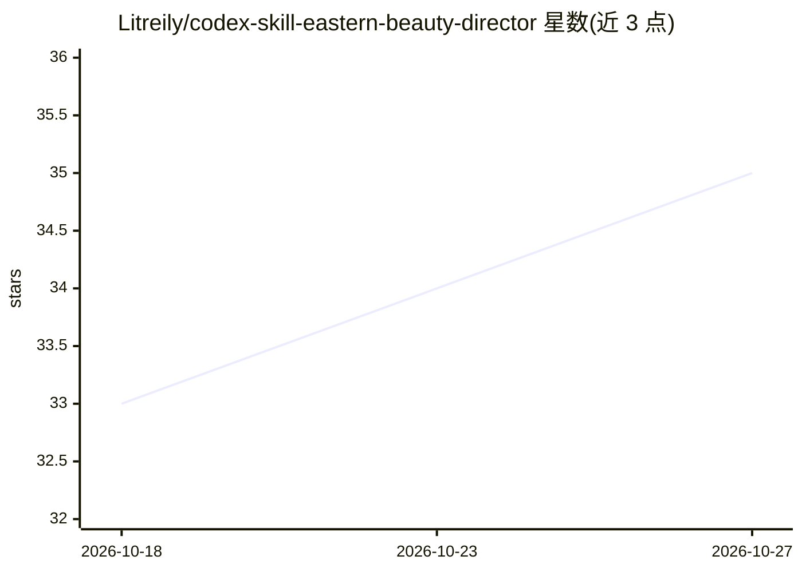

# Litreily/codex-skill-eastern-beauty-director

⭐ 35 · Python · MIT · 推送 2026-07-03 · [GitHub](https://github.com/Litreily/codex-skill-eastern-beauty-director) · 个人维护 · 中文 README

**Codex 东方美人系列 AI 绘画提示词 Skill 包**

一个安装在 Codex skills 目录下的提示词生成技能：用户以中文结构化字段提出「古风美女」「敦煌飞天」「甜系纯欲生活写真」等需求，skill 让 Codex 按执行导演流程输出参数锁定、导演设定、中文主提示词、English prompt、负面提示词与参数建议，供 Midjourney、Stable Diffusion、ComfyUI、GPT image 等工具使用。内置多条风格路线（天象神朝、宋韵茶影等）、审美气质系统、东方美学图鉴与 Cosplay 展会摄影体系。仓库本身不自带图像模型，需 Codex 环境或外部工具生图。

## 筛选速览

| 维度 | 判定 | 备注 |
|---|---|---|
| AI 角色 | `ai-knowledge` | 知识聚合/清单类 |
| 许可风险 | `permissive` | MIT |
| 部署形态 | `None` |  |
| 模型依赖 | — | README 未给出锁定关系 |
| 硬件要求 | — | 无带数字的原话,不猜 |
| 安装摩擦 | `low` | 无编译、无系统依赖或容器化 |
| 成熟度 | — | 结构信号不足 |

## 能力要点

- 中文结构化字段调用，自动补全路线、光线、镜头、负面词与完整 Prompt
- 内置多条古风/东方幻想风格路线与上层审美气质系统（柔美、妩媚、优雅等）
- 东方美学图鉴系统可产出小红书 3:4 图鉴封面与人物页
- examples/ 目录提供 19 个可复制示例，styles/ 提供分主题风格参考文件

## 适用场景

- 让 Codex 把简单的古风美人需求扩写成专业 AI 绘画提示词
- 批量生产东方美学图鉴类小红书封面与人物页内容
- 生成官方展会摄影质感的 Cosplay 角色大片提示词

## 场景标签

`提示工程` · 领域:Agent 开发

## 证据(README 行号)

> L311: - `SKILL.md`：Codex 读取的核心 skill 指令。
> L325: - 这个仓库本身是 Codex Skill，不自带图像模型；它负责让 Codex 按「执行导演」流程写出高质量 AI 绘画提示词。

## 星数曲线

2026-10-18 33 → 2026-10-27 35（+2）

---
*卡片 v1 · prompt 1.4 · 生成 2026-10-25 · 置信度 high · 依据 README sha `8c83bc1179fa` · [字段定义](../../DATASET.md)*
