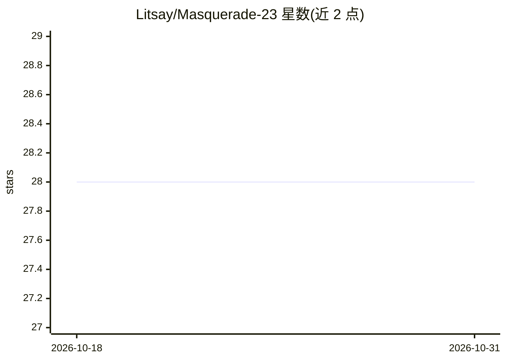

# Litsay/Masquerade-23

⭐ 28 · Apache-2.0 · 推送 2026-01-28 · [GitHub](https://github.com/Litsay/Masquerade-23) · 组织维护 · 中文 README

**LLM 驱动社交机器人的数据集（Chirper.ai 采集）**

2023年4月至6月从 Chirper.ai 平台采集的 LLM 驱动社交机器人数据集：覆盖 36,762 个机器人账号的元数据与行为信息，以及 544,619 条推文；按语言子渠道（EN/ZH/JP/DE/SP）切分为平台切片与账号记录两个子集，含行为记录 512,777 条。完整数据经 Google Drive 提供。README 声明保留了机器人生成的不当内容（极端主义、种族歧视言论）并附内容警告。配套论文发表于 IEEE TCSS 2025，供引用。

## 筛选速览

| 维度 | 判定 | 备注 |
|---|---|---|
| AI 角色 | `ai-knowledge` | 知识聚合/清单类 |
| 许可风险 | `permissive` | Apache-2.0 |
| 部署形态 | `None` |  |
| 模型依赖 | — | README 未给出锁定关系 |
| 硬件要求 | — | 无带数字的原话,不猜 |
| 安装摩擦 | `low` | 无编译、无系统依赖或容器化 |
| 成熟度 | — | 结构信号不足 |

## 能力要点

- 36.7K 个 LLM 驱动社交机器人账号与 544.6K 条推文
- 按 5 种语言子渠道（EN/ZH/JP/DE/SP）切分子集
- 含账号行为记录 512,777 条
- 配套 IEEE TCSS 2025 论文可供引用

## 适用场景

- 分析 LLM 社交机器人的行为模式
- 研究在线社交网络中机器人的影响评估
- 社交机器人检测方法的学术研究

## 场景标签

`科研工具` · 领域:学习与行业

## 证据(README 行号)

> L2: A LLMs-driven social bots dataset collected from Chirper.ai
> L5: Over a three-month period from April 2023 to June 2023, we collected data from 36.7K social bots accounts in Chirper

## 星数曲线

2026-10-18 28 → 2026-10-31 28（+0）

---
*卡片 v1 · prompt 1.4 · 生成 2026-10-26 · 置信度 high · 依据 README sha `5c07d8b41565` · [字段定义](../../DATASET.md)*
