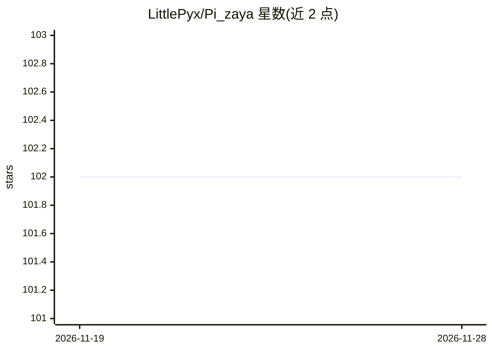

# LittlePyx/Pi_zaya

⭐ 102 · Python · MIT · 推送 2026-10-20 · [GitHub](https://github.com/LittlePyx/Pi_zaya) · [官网](https://github.com/LittlePyx/Pi_zaya/releases) · 个人维护 · 中文 README

**本地学术 PDF 库的证据型问答与引用溯源助手**

面向已有本地论文库的阅读助手：将 PDF 转为带页码锚点的 Markdown 并建立结构化索引，基于 BM25 检索构建 RAG 提示，返回带证据、来源卡片与句级引用核查的回答；回答默认仅使用本地库，模型知识与联网补充需逐会话显式开启且仅在本地证据不足时使用。Research Agent 默认运行，提供计划、工具调用与验证追踪（agent_trace）。产品入口为 FastAPI + React，旧 Streamlit 入口已移除；Windows 提供安装包与便携 ZIP，含嵌入式 Python 运行时。

## 筛选速览

| 维度 | 判定 | 备注 |
|---|---|---|
| AI 角色 | `ai-native` | 本体是模型或模型工具 |
| 许可风险 | `permissive` | MIT |
| 部署形态 | `desktop` | 安装包/桌面程序 |
| 模型依赖 | — | README 未给出锁定关系 |
| 硬件要求 | — | 无带数字的原话,不猜 |
| 安装摩擦 | `low` | 无编译、无系统依赖或容器化 |
| 成熟度 | `idea` | |

## 能力要点

- PDF→带锚点 Markdown 转换，转换任务持久化、重启可恢复
- BM25 默认检索与可选本地稠密检索（显式安装、混合模式）
- 句级引用/证据支持核查与 agent_trace 审计面板
- 证据矩阵与文献篮、来源笔记导出

## 适用场景

- 向本地论文库提问并追溯每条结论到原文位置
- 跨论文比较方法、结果与局限并生成证据矩阵
- 组织带来源的阅读笔记并导出引用

## 场景标签

`RAG` `科研工具` `文档问答` · 领域:知识与检索

## 证据(README 行号)

> L5: Pi_zaya is a local-first, evidence-grounded reading assistant for academic PDFs.
> L81: |Evidence-based QA|Searches the indexed library, builds a RAG prompt from retrieved snippets, and returns grounded 
> L88: |Research Agent|Applies planning, source policy, tool-use tracing, evidence sufficiency, and sentence-level citatio

## 星数曲线

2026-11-19 102 → 2026-11-28 102（+0）

---
*卡片 v1 · prompt 1.4 · 生成 2026-11-19 · 置信度 high · 依据 README sha `5a6bbc3977e5` · [字段定义](../../DATASET.md)*
