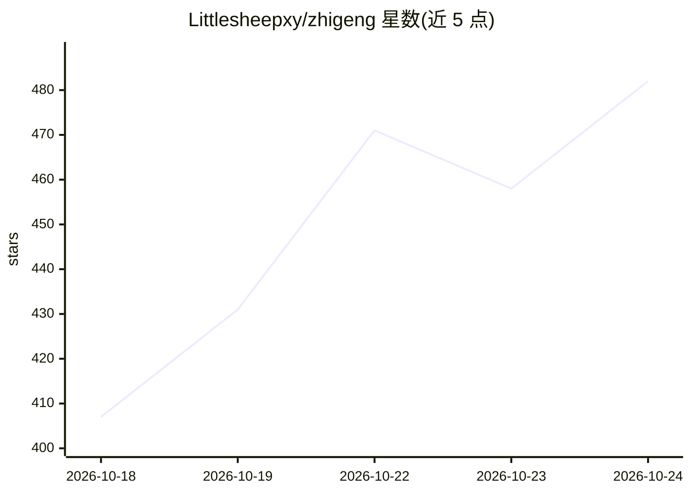

# Littlesheepxy/zhigeng

⭐ 506 · TypeScript · NOASSERTION · 推送 2026-09-01 · [GitHub](https://github.com/Littlesheepxy/zhigeng) · [官网](https://zhigeng.app) · 个人维护 · 中文 README

**Mac 本地优先的语音输入与个人记忆 Agent，BYOK 调度本机 Agent**

面向个人用户的 macOS 语音输入与记忆 Agent：短按右 ⌘ 语音转写并按场景（飞书/微信/邮件）整理成稿，长按右 ⌘ 基于窗口、对话、剪贴板等情境生成多条回复草案，⌥ Space 将任务交给 Codex、Claude Code 等本机 Agent 执行。记忆与轨迹留存在本地，可查看、关闭、删除。语音可走本机 SenseVoice/Whisper，大模型需自填云端 API Key（BYOK，密钥存本机钥匙串）；iOS 输入法版研发中未发布。源码按 PolyForm Noncommercial 1.0.0 开放，禁商用。

## 筛选速览

| 维度 | 判定 | 备注 |
|---|---|---|
| AI 角色 | `ai-native` | 本体是模型或模型工具 |
| 许可风险 | `none` | NOASSERTION |
| 部署形态 | `desktop` | 安装包/桌面程序 |
| 模型依赖 | — | README 未给出锁定关系 |
| 硬件要求 | — | 无带数字的原话,不猜 |
| 安装摩擦 | `low` | 无编译、无系统依赖或容器化 |
| 成熟度 | `idea` | |

## 能力要点

- 右 ⌘ 短按语音成稿、长按情境代回，多条草案点选插入
- 本地轨迹与记忆沉淀（人物、项目、口吻），可看可删
- 调度 Codex / Claude Code 等本机 Agent，可接飞书、钉钉、Slack 等
- 语音可走本地 SenseVoice / Whisper，云端模型 BYOK

## 适用场景

- 用语音快速输入并按场景整理成稿
- 在聊天中一键生成符合上下文的回复草案
- 把复杂任务口头交给本机 Agent 并接收完成通知
- 跨设备延续个人上下文与记忆（iOS 版研发中）

## 场景标签

`AI 助手` `语音识别` · 领域:对话与助手

## 证据(README 行号)

> L17: 知更是一个独立、厂商中立的语音输入与记忆 Agent。它不要求你迁移到新的聊天框，也不把你的记忆锁在某一家模型或大厂账号里。
> L25: 在 Mac 上，知更负责语音输入、情境代回和调度 Codex、Claude Code 等本地 Agent；正在研发的 iOS 版将成为随身记忆终端和本地 Agent 遥控器，让你在路上也能记录上下文、延续工作，并向家中或办公室的 
> L103: 6. **本地优先，钥匙自己拿** — 语音可走本机 ASR；大模型走你自己的 Key（OpenAI / Anthropic / 智谱 / Kimi / OpenRouter / 自定义 Base URL）。

## 星数曲线

2026-10-18 407 → 2026-10-24 482（+75）

---
*卡片 v1 · prompt 1.4 · 生成 2026-10-21 · 置信度 high · 依据 README sha `2bd058129cc9` · [字段定义](../../DATASET.md)*
