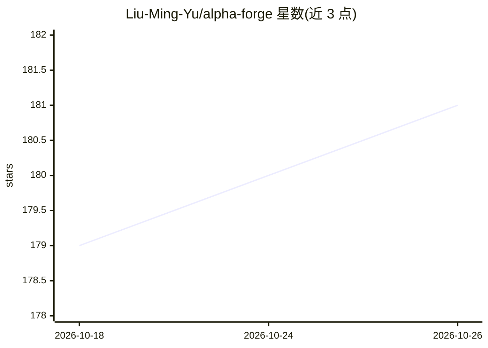

# Liu-Ming-Yu/alpha-forge

⭐ 181 · Python · Apache-2.0 · 推送 2026-08-01 · [GitHub](https://github.com/Liu-Ming-Yu/alpha-forge) · 个人维护 · 中文 README

**面向量化交易者的 Agentic AI 系统化交易操作系统**

将 LLM 原生研究、表征学习、组合治理与 IBKR 执行集成为一体的交易系统：多智能体层把财报、电话会、宏观评论等文本转为受 manifest 约束的 text-event-v2 特征；研究工厂按 campaign 组织假设生成、walk-forward 验证、IC 诊断与 bootstrap 证据；V2 共享账户编排器合并多策略提案，经 Shadow→Paper→Live 分阶段推进，执行层带 fail-closed、kill switch 与对账。Python 3.11 + FastAPI，Docker 就绪。

## 筛选速览

| 维度 | 判定 | 备注 |
|---|---|---|
| AI 角色 | `ai-native` | 本体是模型或模型工具 |
| 许可风险 | `permissive` | Apache-2.0 |
| 部署形态 | `self-host` | docker 或自建部署 |
| 模型依赖 | — | README 未给出锁定关系 |
| 硬件要求 | — | 无带数字的原话,不猜 |
| 安装摩擦 | `low` | 无编译、无系统依赖或容器化 |
| 成熟度 | — | 结构信号不足 |

## 能力要点

- 多智能体 LLM 层生成 manifest 约束、可审计的 text-event-v2 特征
- 自动研究流水线：假设→特征→walk-forward 验证→证据包→晋升决策
- V2 共享账户编排器融合多引擎提案并分阶段部署（Shadow→Paper→Live）
- 执行层提供 fail-closed 经纪商路径、kill switch 与对账

## 适用场景

- 用量化流水线系统化研究、验证并晋升 alpha 策略
- 把非结构化文本（财报/电话会/新闻）转为可回测治理的特征
- 在单一账户上治理多策略组合并安全对接 IBKR 执行

## 场景标签

`多智能体` `金融量化` · 领域:Agent 开发

## 证据(README 行号)

> L6:  Agentic AI infrastructure for systematic trading.
> L8:  Alpha Forge brings LLM-native research, representation learning, portfolio
> L9:  governance, and IBKR-ready execution into one quiet, auditable operator

## 星数曲线

2026-10-18 179 → 2026-10-26 181（+2）

---
*卡片 v1 · prompt 1.4 · 生成 2026-10-22 · 置信度 mid · 依据 README sha `e115b55c2d8e` · [字段定义](../../DATASET.md)*
