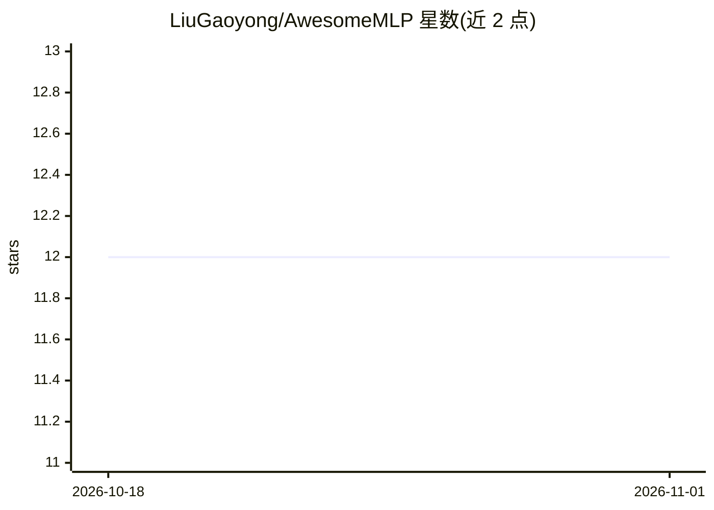

# LiuGaoyong/AwesomeMLP

⭐ 12 · GPL-3.0 · 推送 2025-12-28 · [GitHub](https://github.com/LiuGaoyong/AwesomeMLP) · 个人维护

**机器学习原子间势软件与工具的策展清单**

AwesomeMLP 是一个机器学习原子间势（Interatomic Potentials）主题的 awesome 清单，收录 DeepChem、SchNetPack、TorchANI、NequIP、MLatom 等约 20 个软件条目，覆盖软件、其他工具与相关清单三个分区；每条目仅给出名称与一句话描述，多为分子模拟、量子化学与材料科学领域的神经网络势函数或机器学习包。另设 See Also 区链接其他化学类 awesome 清单。仓库本身不提供代码或安装方式。

## 筛选速览

| 维度 | 判定 | 备注 |
|---|---|---|
| AI 角色 | `ai-knowledge` | 知识聚合/清单类 |
| 许可风险 | `viral` | GPL-3.0 |
| 部署形态 | `None` |  |
| 模型依赖 | — | README 未给出锁定关系 |
| 硬件要求 | — | 无带数字的原话,不猜 |
| 安装摩擦 | `low` | 无编译、无系统依赖或容器化 |
| 成熟度 | — | 结构信号不足 |

## 能力要点

- 收录约 20 个机器学习原子间势相关软件条目
- 按 Software / Other / See Also 三区组织
- 附带关联的化学与 PyTorch 清单链接

## 适用场景

- 查找分子模拟与材料科学领域的神经网络势软件
- 对比各机器学习原子间势包的功能定位

## 场景标签

`精选清单` · 领域:学习与行业

## 证据(README 行号)

> L1: Awesome Machine Learning Interatomic Potentials
> L5: ## Software
> L31: ## See Also

## 星数曲线

2026-10-18 12 → 2026-11-01 12（+0）

---
*卡片 v1 · prompt 1.4 · 生成 2026-11-01 · 置信度 high · 依据 README sha `a79eb08743b4` · [字段定义](../../DATASET.md)*
