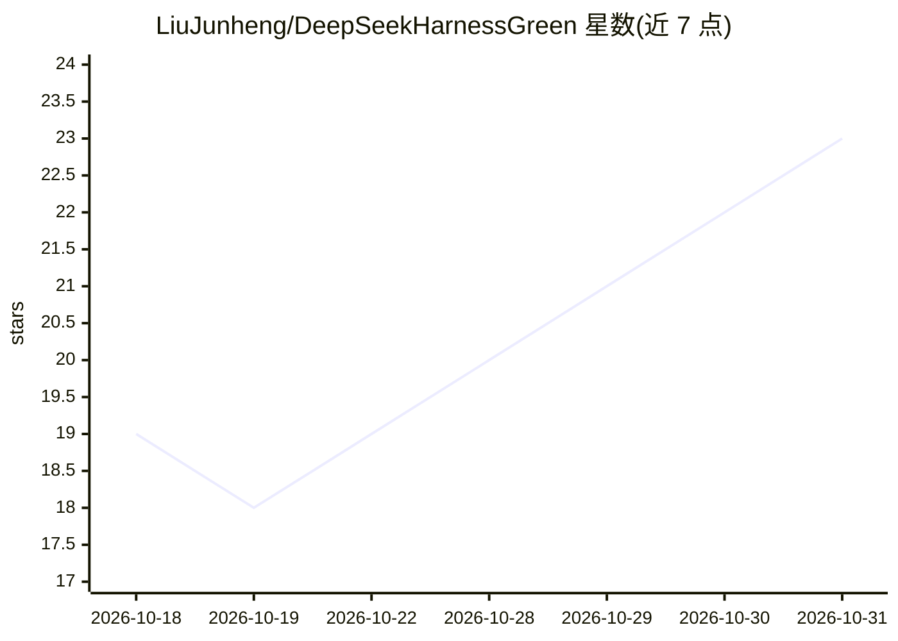

# LiuJunheng/DeepSeekHarnessGreen

⭐ 23 · JavaScript · Apache-2.0 · 推送 2026-10-28 · [GitHub](https://github.com/LiuJunheng/DeepSeekHarnessGreen) · [官网](https://dsh-green.website/) · 个人维护 · 中文 README

**把 DeepSeek Harness 封装成双击即用的 Windows 绿色桌面启动器**

面向 Windows 用户的绿色整合版启动器：把 dsh（DeepSeek Harness CLI agent）封装为 DSH_Launcher.exe 双击运行，首次点击「安装环境」自动下载便携 Node/Python 并本地安装 dsh；所有运行时与数据集中在 runtime/ 目录，不改 PATH、不写注册表，整目录可迁移。内置 13 款纯插件，含 Ollama 本地模型接入、跨会话记忆库、规则注入、技能中心、用量统计与会话回退/永久删除（官方无此功能）。默认以 WebView2 独立桌面窗口打开 WebUI，也可切系统浏览器；支持局域网绑定与官方核心/绿色外围双通道独立更新。Apache 2.0 开源。

## 筛选速览

| 维度 | 判定 | 备注 |
|---|---|---|
| AI 角色 | `ai-ecosystem` | LLM/agent 周边工具 |
| 许可风险 | `permissive` | Apache-2.0 |
| 部署形态 | `desktop` | 安装包/桌面程序 |
| 模型依赖 | local-ok | 支持本地模型 |
| 硬件要求 | — | 无带数字的原话,不猜 |
| 安装摩擦 | `low` | 无编译、无系统依赖或容器化 |
| 成熟度 | — | 结构信号不足 |

## 能力要点

- 双击即用：内置便携 Node/Python，全部数据集中在 runtime/，整目录迁移即用
- 内置 13 款插件：Ollama 接入、跨会话记忆库、规则注入、技能中心、会话回退/永久删除等
- 桌面窗口（WebView2）与网页窗口可切换，支持局域网远程访问
- 官方 dsh 与绿色版外围双通道独立自更新，更新前自动备份

## 适用场景

- 不想装 Python/Node 就在桌面窗口里使用 DeepSeek Harness
- 在 U 盘/多台电脑间整体迁移 dsh 环境与会话数据
- 手机或其他电脑通过局域网访问本机 dsh 服务
- 管理会话归档、恢复与永久删除等官方未提供的操作

## 场景标签

 · 领域:AI Agent 桌面工具/本地运行环境

## 证据(README 行号)

> L5: 把 DeepSeek Harness（`dsh`）封装成**双击即用**的本地启动器：不用敲命令、不用单独装 Python / Node、不用手动开浏览器，整包拷走就能用。如同三军帐中一纸调令，点一下即可出征。
> L24: 4. 网页里：设置 → 模型 → 填入 **DeepSeek API Key**，并**选择工作区**（让 AI 干活的文件夹）；
> L14: - **📦 内置 13 款实用插件**：会话回退 / 导入、用量统计、文件浏览、清理归档、侧边栏、背景影画、**Ollama 本地大模型接入**、**祖宗记忆库（跨会话自动记忆，v3 默认关闭）**、**用户规则注入（类似 TRA

## 星数曲线

2026-10-18 19 → 2026-10-31 23（+4）

---
*卡片 v1 · prompt 1.4 · 生成 2026-10-28 · 置信度 mid · 依据 README sha `d42c5636fc7d` · [字段定义](../../DATASET.md)*
