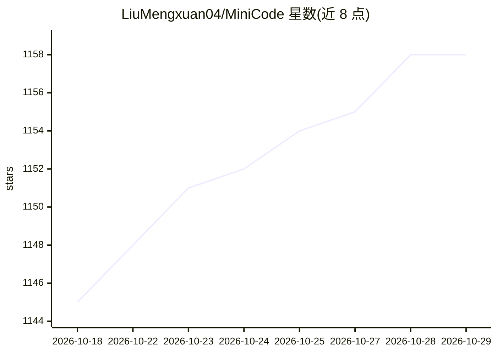

# LiuMengxuan04/MiniCode

⭐ 1,158 · TypeScript · MIT · 推送 2026-10-09 · [GitHub](https://github.com/LiuMengxuan04/MiniCode) · [官网](https://liumengxuan04.github.io/MiniCode/) · 组织维护 · 中文 README

**轻量终端编码助手：类 Claude Code 工作流的学习型实现**

面向本地开发工作流的终端编码助手，以紧凑代码复现 Claude Code 式 agent 循环：接收请求、检查工作区、调用工具、写前审查、返回响应。提供多步工具执行、最多 3 个只读子 agent、Todo 计划与跨轮 Goal、全屏 TUI、会话持久化、上下文自动压缩、本地 SKILL.md 技能与 MCP 接入。安装时配置模型名与 Anthropic 兼容 BASE_URL/AUTH_TOKEN，另提供 Rust/Python/Go/Java 多语言版本，定位为学习、实验与定制工具的参考实现。

## 筛选速览

| 维度 | 判定 | 备注 |
|---|---|---|
| AI 角色 | `ai-ecosystem` | LLM/agent 周边工具 |
| 许可风险 | `permissive` | MIT |
| 部署形态 | `library` | 以包/库形式分发 |
| 模型依赖 | locked-api |  |
| 硬件要求 | — | 无带数字的原话,不猜 |
| 安装摩擦 | `low` | 无编译、无系统依赖或容器化 |
| 成熟度 | — | 结构信号不足 |

## 能力要点

- model→tool→model 多步工具循环与写前审查、路径/命令权限检查
- 最多 3 个并发只读子 agent，根 agent 拥有全部代码变更
- 全屏 TUI：斜杠命令菜单、审批流、会话持久化与恢复
- 本地 SKILL.md 技能发现与 MCP（stdio/远程 HTTP）工具/资源/提示接入
- 上下文用量统计、auto-compact、context collapse 等长会话机制

## 适用场景

- 在终端里让 agent 代为读代码、改文件、跑命令完成编码任务
- 学习或魔改一个类 Claude Code 的 agent 架构
- 通过 SKILL.md 和 MCP 扩展自己的编码工作流工具

## 场景标签

`编码 Agent` · 领域:编码与开发

## 证据(README 行号)

> L21: MiniCode is a lightweight terminal coding assistant for local development workflows.
> L23: It provides Claude Code-like workflow and architectural ideas in a much smaller implementation, making it especiall
> L117: - a reference implementation for Claude Code-like agent architecture

## 星数曲线

2026-10-18 1,145 → 2026-10-29 1,158（+13）

---
*卡片 v1 · prompt 1.4 · 生成 2026-10-21 · 置信度 high · 依据 README sha `da6b3a9b2025` · [字段定义](../../DATASET.md)*
