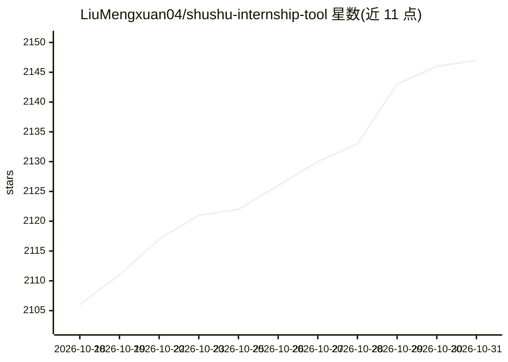

# LiuMengxuan04/shushu-internship-tool

⭐ 2,147 · Python · NOASSERTION · 推送 2026-06-24 · [GitHub](https://github.com/LiuMengxuan04/shushu-internship-tool) · 个人维护 · 中文 README

**帮低经验求职者把 JD 转成可面试项目的 AI 技能包**

面向计算机方向求职者的 AI 驱动实习准备工具包（skill），配合 Codex 等支持交互式规划模式的 coding agent 使用：输入岗位描述（JD）后，完成 JD 理解、GitHub 项目筛选排序（含项目偏好/taste 权重）、本地项目审计、可面试改造点推进，并生成 STAR 简历、面试 Q&A、PPT 提示词等面试材料。附 Python 本地脚本做项目审计与候选打分，打分要求 AI 助手显式写入匹配项与分数字段，脚本不解析自然语言偏好。Apache-2.0 许可。

## 筛选速览

| 维度 | 判定 | 备注 |
|---|---|---|
| AI 角色 | `ai-native` | 本体是模型或模型工具 |
| 许可风险 | `none` | NOASSERTION |
| 部署形态 | `library` | 以包/库形式分发 |
| 模型依赖 | — | README 未给出锁定关系 |
| 硬件要求 | — | 无带数字的原话,不猜 |
| 安装摩擦 | `low` | 无编译、无系统依赖或容器化 |
| 成熟度 | — | 结构信号不足 |

## 能力要点

- 按 JD 匹配度等维度筛选排序 2-3 个 GitHub 开源项目，支持正向偏好与避雷项权重
- 审计已 clone 项目，生成 audit.json / overview.md / overview.html
- 生成 STAR 简历项目、面试拷问 Q&A、PPT 提示词与投递检查表
- 提供 candidate_score / repo_audit / interview_pack 等 Python 脚本与命令入口

## 适用场景

- 只有岗位 JD，想快速选定并跑通一个可写进简历的项目
- 把已有项目经历整理成简历表达和面试问答材料
- 在 Codex 计划模式下通过弹窗交互确认项目偏好后获得定制推荐

## 场景标签

 · 领域:求职/职业发展工具

## 证据(README 行号)

> L18: 鼠鼠实习妙妙工具是一个AI驱动的实习项目准备工具包（skill）：把目标 JD（Job Description，岗位描述/招聘需求）快速转成能投递、能面试、能讲清的项目素材闭环。这里的 JD 通常包括岗位职责、任职要求、技术栈、业
> L20: 它适合后端、前端、全栈、移动端、测试开发、数据工程、云原生/DevOps、安全、系统、AI/算法等计算机方向，旨在帮 0 经验或低经验候选人（鼠鼠）用最短路径完成：选题、理解、复现、简历表达、面试拷问和展示材料。

## 星数曲线

2026-10-18 2,106 → 2026-10-31 2,147（+41）

---
*卡片 v1 · prompt 1.4 · 生成 2026-10-21 · 置信度 high · 依据 README sha `1354038ec7bd` · [字段定义](../../DATASET.md)*
