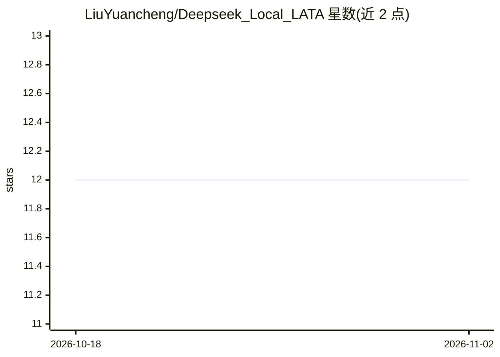

# LiuYuancheng/Deepseek_Local_LATA

⭐ 12 · Python · MIT · 推送 2026-08-04 · [GitHub](https://github.com/LiuYuancheng/Deepseek_Local_LATA) · 个人维护

**DeepSeek 本地部署的学习文章、测试与应用合集**

个人维护的混合仓库，围绕在本地（PC/服务器）部署 DeepSeek LLM 组织四类内容：学习资料（书籍、示例、链接、视频）、实操文章、测试程序（提示工程、RAG 探索）与应用源码。收录项目包括本地部署 DeepSeek-R1 并接入自定义 RAG 知识库、用 Flask 网页封装将本地 DeepSeek-R1 服务共享给局域网用户、基于 MCP 与 browser-use 的浏览器控制 Agent，以及用本地 GPU 运行 Qwen/DeepSeek-R1 支撑多个 OpenClaw 助手集群。各项目附 LinkedIn 文章链接与对应源码目录。

## 筛选速览

| 维度 | 判定 | 备注 |
|---|---|---|
| AI 角色 | `ai-knowledge` | 知识聚合/清单类 |
| 许可风险 | `permissive` | MIT |
| 部署形态 | `None` |  |
| 模型依赖 | local-ok | 支持本地模型 |
| 硬件要求 | — | 无带数字的原话,不猜 |
| 安装摩擦 | `low` | 无编译、无系统依赖或容器化 |
| 成熟度 | — | 结构信号不足 |

## 能力要点

- 四大板块：学习资料、文章、测试程序、应用源码
- 本地部署 DeepSeek-R1 并接入自定义 RAG 知识库的完整方案
- Flask 封装将 Ollama 托管的本地模型共享给局域网用户
- MCP + browser-use 的浏览器控制 Agent 与多 OpenClaw 助手集群部署

## 适用场景

- 学习如何在本地部署和使用 DeepSeek 模型
- 参考 RAG 知识库与局域网模型服务共享的实践方案
- 搭建本地 GPU 推理以替代云端 AI API 降低 token 成本

## 场景标签

`教程课程` `RAG` · 领域:知识与检索

## 证据(README 行号)

> L2: **Project Design Purpose** : A repo includes (L)earning, (A)rticles, (T)esting and (A)pplication program with settin
> L4: - **Learning (L):** A curated collection of learning resources, including books, programming examples, relevant link
> L5: - **Articles (A):** Step-by-step guides, tutorials, and technical write-ups covering installation, configuration, te
> L6: - **Testing (T):** A suite of simple test programs aimed at exploring different technologies, such as prompt enginee

## 星数曲线

2026-10-18 12 → 2026-11-02 12（+0）

---
*卡片 v1 · prompt 1.4 · 生成 2026-11-01 · 置信度 high · 依据 README sha `11b41e3efe5d` · [字段定义](../../DATASET.md)*
