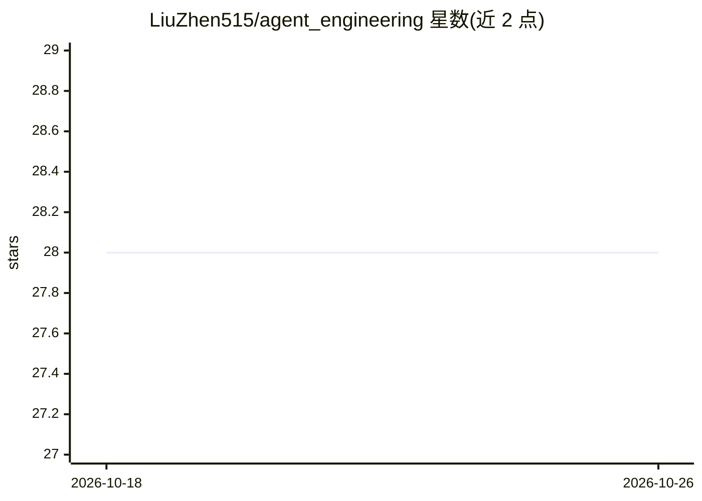

# LiuZhen515/agent_engineering

⭐ 28 · NOASSERTION · 推送 2026-06-30 · [GitHub](https://github.com/LiuZhen515/agent_engineering) · 个人维护 · 中文 README

**开源中文书籍：将 LLM 智能体系统拆解为四种工程范式**

一本以 CC BY-NC-SA 4.0 许可发布的中文开源书籍，主题为大语言模型驱动的智能体系统工程。核心框架将 Agent 系统拆为四个递进层次：提示词工程（Token 层）、上下文工程（Window 层）、驾驭工程（Runtime 层）、循环工程（System 层），每层有独立的设计方法、工程挑战与评估指标。面向 AI 应用开发者、架构师、产品经理与研究者，配套代码位于独立仓库 agent-engineering-code。

## 筛选速览

| 维度 | 判定 | 备注 |
|---|---|---|
| AI 角色 | `ai-knowledge` | 知识聚合/清单类 |
| 许可风险 | `none` | NOASSERTION |
| 部署形态 | `None` |  |
| 模型依赖 | — | README 未给出锁定关系 |
| 硬件要求 | — | 无带数字的原话,不猜 |
| 安装摩擦 | `low` | 无编译、无系统依赖或容器化 |
| 成熟度 | — | 结构信号不足 |

## 能力要点

- 四层递进框架：Prompt · Context · Harness · Loop
- 每层定义独立的设计方法、工程挑战与评估指标
- 配套代码仓库 agent-engineering-code 提供脚本
- CC BY-NC-SA 4.0 许可的社区共建开源书籍

## 适用场景

- 系统学习 Agent 工程的分层框架与术语
- 为团队选型技术栈和工程范式提供决策参考
- 研究者了解工业界如何工程化构建 Agent 系统

## 场景标签

`教程课程` · 领域:学习与行业

## 证据(README 行号)

> L26: ## 核心框架：四种递进的工程范式
> L28: 本书将智能体系统拆解为四个层次，从微观到宏观、从静态到动态逐层递进：

## 星数曲线

2026-10-18 28 → 2026-10-26 28（+0）

---
*卡片 v1 · prompt 1.4 · 生成 2026-10-26 · 置信度 high · 依据 README sha `35efee915536` · [字段定义](../../DATASET.md)*
