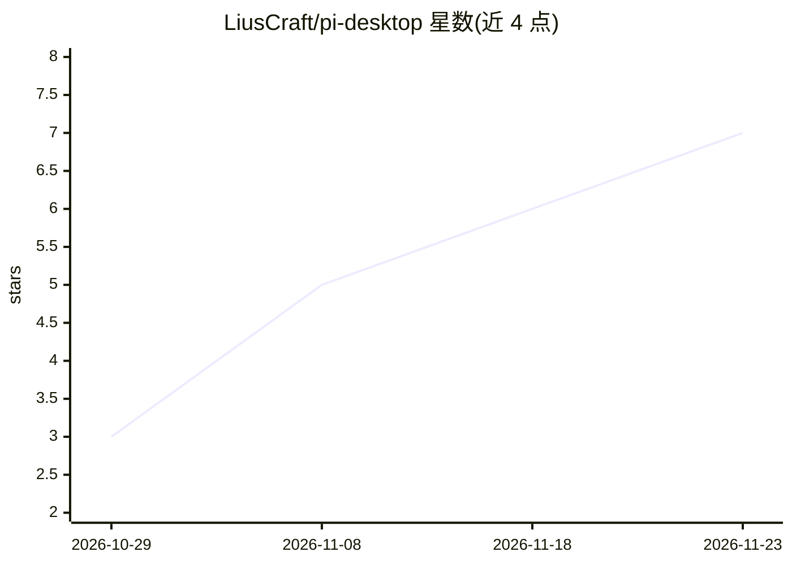

# LiusCraft/pi-desktop

⭐ 7 · TypeScript · MIT · 推送 2026-11-20 · [GitHub](https://github.com/LiusCraft/pi-desktop) · [官网](https://liuscraft.github.io/pi-desktop/) · 个人维护 · 中文 README

**pi coding agent 的桌面客户端，Work/Code 双模式**

基于 Electron + React + TypeScript 的桌面应用，通过 pi SDK（createAgentSession）驱动 coding agent，会话运行在常驻 Electron utilityProcess 中。提供 Code 模式（git worktree 隔离、diff、PR/CI 状态）与 Work 模式（文件夹内知识类任务），并以内置 desktop-kit 扩展补足权限模式、计划审批、待办、子 agent、定时任务等能力。安装支持 macOS brew cask、Windows 安装包、Linux AppImage 与源码运行；模型接入复用 pi CLI 的 OAuth/API key/自定义端点配置。

## 筛选速览

| 维度 | 判定 | 备注 |
|---|---|---|
| AI 角色 | `ai-ecosystem` | LLM/agent 周边工具 |
| 许可风险 | `permissive` | MIT |
| 部署形态 | `desktop` | 安装包/桌面程序 |
| 模型依赖 | — | README 未给出锁定关系 |
| 硬件要求 | — | 无带数字的原话,不猜 |
| 安装摩擦 | `medium` | 含编译或系统依赖之一 |
| 成熟度 | — | 结构信号不足 |

## 能力要点

- Code 模式：每会话独立 git worktree，配 diff、PR/CI 状态与自动修/自动合并
- Work 模式：在选定文件夹执行整理文件、写文档等知识类任务
- 复用 pi CLI 的配置体系（auth.json/models.json/扩展/技能/MCP）
- 支持离线演示模型，不配置 API Key 可体验完整流程

## 适用场景

- 在桌面端以图形界面管理 coding agent 会话与 PR
- 每个代码任务用独立 worktree 并行开发互不干扰
- 定时运行 agent 任务并远程遥控另一台电脑上的实例

## 场景标签

`编码 Agent` `AI 助手` · 领域:编码与开发

## 证据(README 行号)

> L3: **pi coding agent 的桌面端 · 仿 Claude desktop 的 Work / Code 双模式**
> L40: 界面仿照 Claude desktop，有 **Work** 和 **Code** 两种模式。界面用 React + TypeScript + shadcn/ui 构建；agent 直接复用 **pi SDK**（`createA

## 星数曲线

2026-10-29 3 → 2026-11-23 7（+4）

---
*卡片 v1 · prompt 1.4 · 生成 2026-11-20 · 置信度 mid · 依据 README sha `267bb6445f3b` · [字段定义](../../DATASET.md)*
