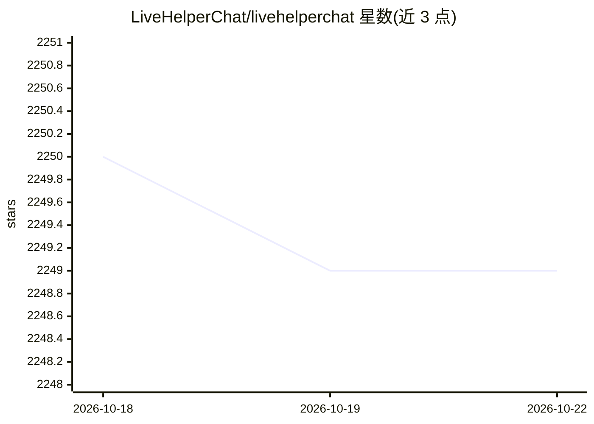

# LiveHelperChat/livehelperchat

⭐ 2,249 · PHP · Apache-2.0 · 推送 2026-10-22 · [GitHub](https://github.com/LiveHelperChat/livehelperchat) · [官网](http://livehelperchat.com) · 组织维护

**面向网站的在线客服聊天系统，支持 AI 机器人与多渠道接入**

开源 PHP 客服聊天应用：在网站上部署在线客服，支持多坐席、部门分配、访客追踪、主动邀请、FAQ、语音视频屏幕共享（Agora/Jitsi）等功能。可接入 Telegram、WhatsApp、Facebook Messenger 等渠道，机器人框架支持对接第三方 AI（ChatGPT、Ollama、Gemini、Rasa、Dialogflow），并提供 MCP 配置、DeepPavlov 情感分析与辱骂检测。提供移动/桌面客户端、Docker 与 Node.js 部署方式，官方称生产环境可日均处理万级会话。安装方式为 git clone 后 composer 依赖（PHP ≥8.2）或下载 release 包。

## 筛选速览

| 维度 | 判定 | 备注 |
|---|---|---|
| AI 角色 | `ai-enhanced` | 去掉 AI 部分产品仍成立 |
| 许可风险 | `permissive` | Apache-2.0 |
| 部署形态 | `library` | 以包/库形式分发 |
| 模型依赖 | local-ok | 支持本地模型 |
| 硬件要求 | — | 无带数字的原话,不猜 |
| 安装摩擦 | `low` | 无编译、无系统依赖或容器化 |
| 成熟度 | — | 结构信号不足 |

## 能力要点

- 机器人框架可对接任意第三方 AI（ChatGPT/Ollama/Gemini/Rasa/Dialogflow）
- 多渠道接入：Telegram、WhatsApp、Viber、Discord 等
- 语音/视频/屏幕共享（Agora 付费与 Jitsi 免费）
- 移动端、桌面端（Electron）与 Docker/Node.js 部署支持

## 适用场景

- 在网站上部署多坐席在线客服系统
- 通过 AI 机器人自动应答访客咨询
- 聚合 Telegram/WhatsApp 等消息渠道统一处理
- 高负载环境下的客服会话处理与统计

## 场景标签

`聊天机器人` · 领域:对话与助手

## 证据(README 行号)

> L3: It's an open-source powered application that brings simplicity and usability into one place. With Live Helper Chat, 
> L54:  * Bot with the possibility to integrate any third-party AI
> L139:  * Bot with the possibility to integrate any third-party AI

## 星数曲线

2026-10-18 2,250 → 2026-10-22 2,249（-1）

---
*卡片 v1 · prompt 1.4 · 生成 2026-10-21 · 置信度 mid · 依据 README sha `70f639f3915e` · [字段定义](../../DATASET.md)*
