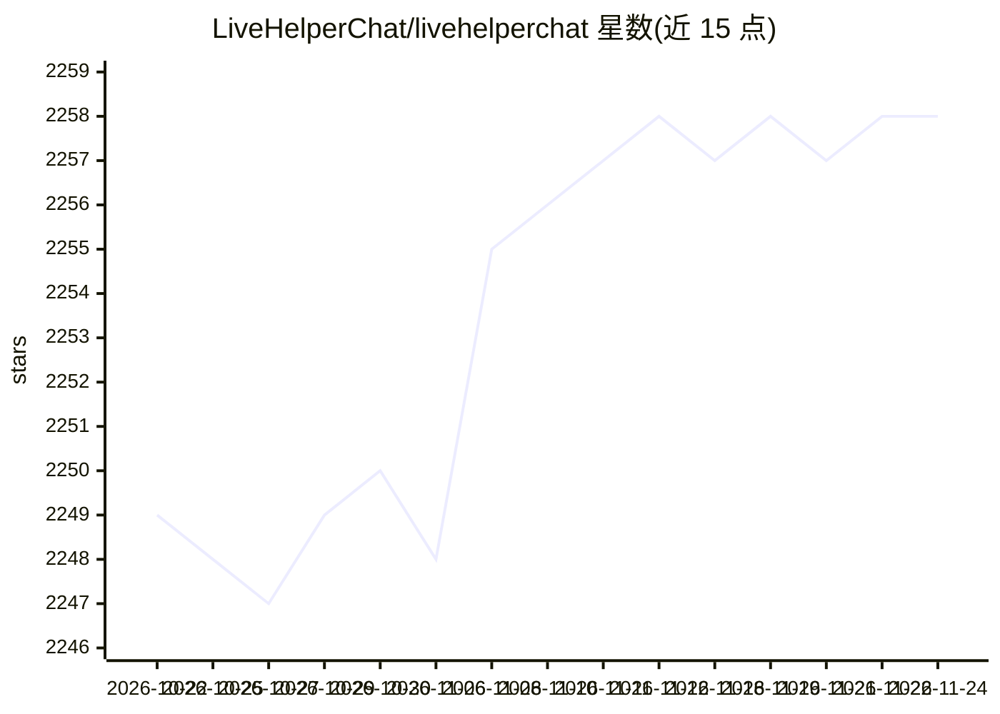

# LiveHelperChat/livehelperchat

⭐ 2,258 · PHP · Apache-2.0 · 推送 2026-11-22 · [GitHub](https://github.com/LiveHelperChat/livehelperchat) · [官网](http://livehelperchat.com) · 个人维护

**给网站提供开源在线客服系统的应用**

开源自托管Live Support应用，为网站提供访客聊天、客服工位与消息分发能力。支持多客服同时处理会话、部门与队列管理、会话存档与统计、主动邀请、地理与访问轨迹追踪，并提供Web与移动端、Windows/Linux/Mac桌面客户端。机器人层可接入第三方AI服务（ChatGPT、Ollama、Rasa、Dialogflow、Gemini等），另支持Telegram、WhatsApp、Messenger等渠道及语音视频与屏幕共享（Agora/Jitsi）。安装需PHP 8.2以上并通过composer或release包部署。

## 筛选速览

| 维度 | 判定 | 备注 |
|---|---|---|
| AI 角色 | `ai-enhanced` | 去掉 AI 部分产品仍成立 |
| 许可风险 | `permissive` | Apache-2.0 |
| 部署形态 | `library` | 以包/库形式分发 |
| 模型依赖 | local-ok | 支持本地模型 |
| 硬件要求 | — | 无带数字的原话,不猜 |
| 安装摩擦 | `low` | 无编译、无系统依赖或容器化 |
| 成熟度 | — | 结构信号不足 |

## 能力要点

- Bot支持接入任意第三方AI（ChatGPT/Ollama/Rasa/Dialogflow/Gemini集成文档）
- 多渠道接入：Telegram、Viber、Discord、WhatsApp（Twilio/open-wa）、Messenger
- 基于Agora（付费）与Jitsi（免费）的语音、视频与屏幕共享
- 桌面（Electron）与移动端（Flutter）客户端，Windows/Linux/Mac原生应用

## 适用场景

- 给公司网站嵌入在线客服窗口，客服团队多坐席接待
- 用机器人接入AI自动回复访客常见问题
- 统一管理Telegram、WhatsApp等渠道的客户消息

## 场景标签

`聊天机器人` · 领域:对话与助手

## 证据(README 行号)

> L3: It's an open-source powered application that brings simplicity and usability into one place. With Live Helper Chat, 
> L54:  * Bot with the possibility to integrate any third-party AI

## 星数曲线

2026-10-22 2,249 → 2026-11-24 2,258（+9）

---
*卡片 v1 · prompt 1.4 · 生成 2026-11-24 · 置信度 mid · 依据 README sha `e64d04bdcc9d` · [字段定义](../../DATASET.md)*
