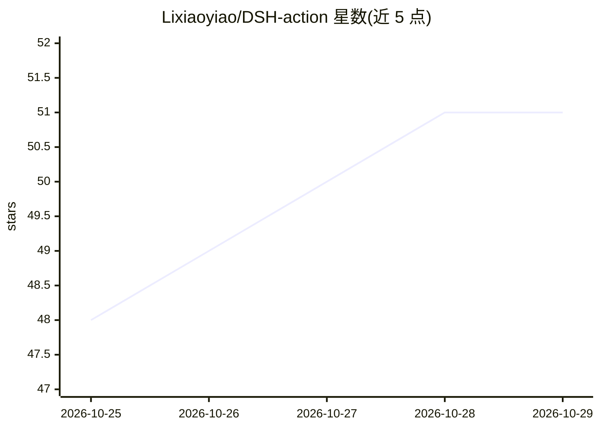

# Lixiaoyiao/DSH-action

⭐ 51 · TypeScript · MIT · 推送 2026-10-23 · [GitHub](https://github.com/Lixiaoyiao/DSH-action) · 个人维护 · 中文 README

**在 GitHub Actions 中运行 DeepSeek Harness 的社区 Action：AI 审查、CI 诊断与修复**

社区维护的 GitHub Action，将 DeepSeek Harness（DSH）接入 PR/Issue/失败 CI 流程，在 GitHub 托管的 Linux runner 上启动凭据隔离的 DSH worker，由受信 Controller 发布评论或经验证的变更。核心能力包括 PR 审查、CI 日志诊断与修复、Issue 转实现为 PR、图片读取与会话恢复。默认 controlled 组合模式保留工具画像与权限边界，实验性 native 模式运行于锁定的 DSH 0.2.1-rc.2 运行时且仅限 Docker。通过 npm create dsh-action 安装器生成 workflow 文件，需配置 DEEPSEEK_API_KEY secret；非官方 DeepSeek 或 GitHub 产品。

## 筛选速览

| 维度 | 判定 | 备注 |
|---|---|---|
| AI 角色 | `ai-native` | 本体是模型或模型工具 |
| 许可风险 | `permissive` | MIT |
| 部署形态 | `self-host` | docker 或自建部署 |
| 模型依赖 | locked-api |  |
| 硬件要求 | — | 无带数字的原话,不猜 |
| 安装摩擦 | `low` | 无编译、无系统依赖或容器化 |
| 成熟度 | `idea` | |

## 能力要点

- 在 GitHub PR/Issue 评论中通过 @dsh 触发 AI 任务（读、分析、修复、Issue→PR）
- 凭据隔离 worker + 受信 Controller 发布的验证式写入流程
- controlled 默认与实验性 native（Docker 专属）两种组合模式
- 自动 PR 审查、CI 失败诊断与修复、Session 断点续跑

## 适用场景

- 让 AI 在 PR 上自动审查新提交并给出内联发现
- 在 Issue 中 @dsh 提问或将需求实现为验证后的 PR
- 读取失败的 CI 检查与日志并给出诊断或经授权的修复

## 场景标签

`代码审查` `编码 Agent` · 领域:编码与开发

## 证据(README 行号)

> L11: Run DeepSeek Harness directly from GitHub pull requests, issues, failed CI jobs, and maintainer-authored automation
> L14: GitHub PR / Issue / CI  →  DeepSeek Harness  →  Review / Diagnose / Fix / Issue → PR
> L17: The Action starts a credential-isolated DSH worker, validates its structured result, and lets a trusted Controller 

## 星数曲线

2026-10-25 48 → 2026-10-29 51（+3）

---
*卡片 v1 · prompt 1.4 · 生成 2026-10-25 · 置信度 mid · 依据 README sha `3aae1fe7c8a8` · [字段定义](../../DATASET.md)*
