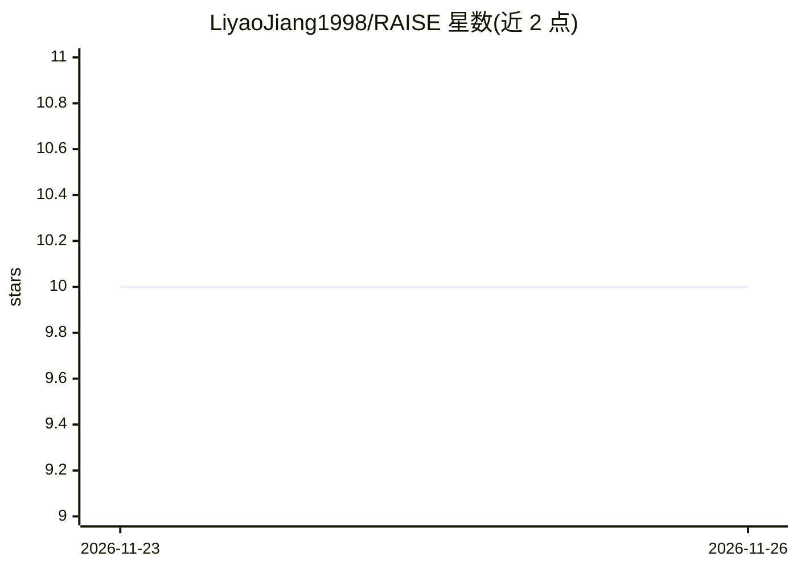

# LiyaoJiang1998/RAISE

⭐ 10 · Python · 推送 2026-06-03 · [GitHub](https://github.com/LiyaoJiang1998/RAISE) · [官网](https://arxiv.org/abs/2603.00483) · 个人维护

**免训练的需求自适应文生图对齐框架，供研究复现**

CVPR 2026 论文 RAISE 的官方实现：将文生图生成建模为需求驱动的自适应推理时扩展过程，通过候选种群进化执行提示改写、噪声重采样与指令编辑等精炼动作，并按结构化需求清单校验每张生成图，仅为未满足项追加计算。仓库提供 LangGraph 流水线、基线生成图、GenEval 运行器与提示基准文件；安装需 conda 环境、pip 依赖、Grounded-SAM-2 校验器及 Ollama 拉取指定 VLM，生成结果以图像和 JSON 保存。

## 筛选速览

| 维度 | 判定 | 备注 |
|---|---|---|
| AI 角色 | `ai-native` | 本体是模型或模型工具 |
| 许可风险 | `none` | — |
| 部署形态 | `library` | 以包/库形式分发 |
| 模型依赖 | local-ok | 支持本地模型 |
| 硬件要求 | — | 无带数字的原话,不猜 |
| 安装摩擦 | `low` | 无编译、无系统依赖或容器化 |
| 成熟度 | — | 结构信号不足 |

## 能力要点

- 免训练、需求驱动的多轮自改进生成框架
- 结构化需求清单校验并按需分配计算（GenEval 0.94，采样量减少 30-40%、VLM 调用减少 80%）
- 提供 LangGraph 多节点生成图与 GenEval 运行器
- 附带 DrawBench/GenEval 提示基准文件

## 适用场景

- 复现论文中复杂提示的文生图对齐实验
- 在 GenEval/DrawBench 上评估免训练推理时扩展方法
- 基于本地 Ollama VLM 生成图像

## 场景标签

`图像生成` · 领域:内容生成

## 证据(README 行号)

> L8: Official implementation of **RAISE** (**R**equirement-**A**daptive **S**elf-**I**mproving **E**volution), a training
> L16: RAISE builds a multi-node generation graph that refines prompts and validates outputs through requirement-driven mu

## 星数曲线

2026-11-23 10 → 2026-11-26 10（+0）

---
*卡片 v1 · prompt 1.4 · 生成 2026-11-23 · 置信度 high · 依据 README sha `733580ddf1f2` · [字段定义](../../DATASET.md)*
