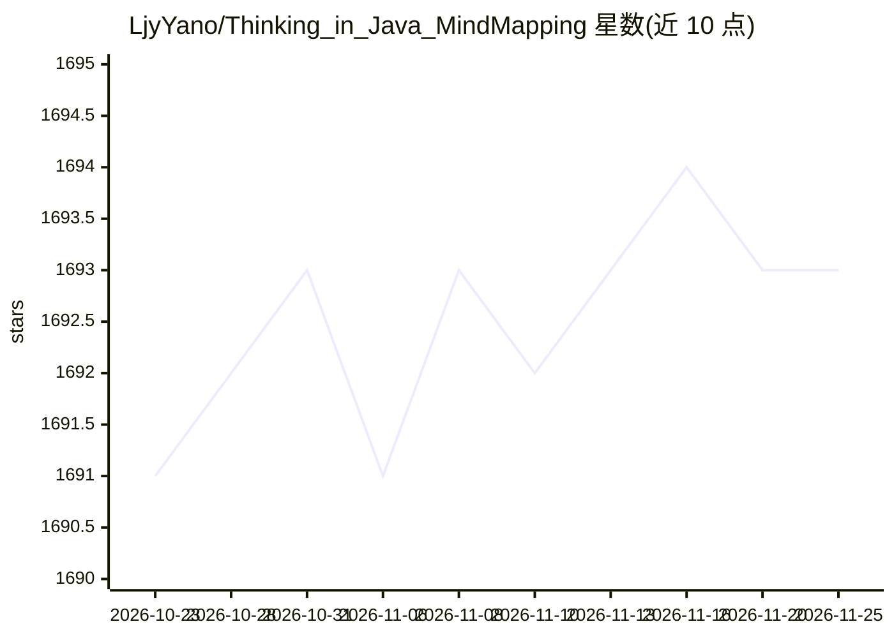

# LjyYano/Thinking_in_Java_MindMapping

⭐ 1,693 · Python · NOASSERTION · 推送 2026-11-23 · [GitHub](https://github.com/LjyYano/Thinking_in_Java_MindMapping) · [官网](https://yano-nankai.notion.site/Yano-Space-ff42bde7acd1467eb3ae63dc0d4a9f8c) · 个人维护 · 中文 README

**个人技术知识库：Java 后端与 AI/Agent 工程笔记及思维导图**

始于 2017 年《Java 编程思想》思维导图整理，现发展为覆盖 Java/JVM、Redis、Spring、Netty 等后端主题以及 Agent、MCP、RAG、模型评测等 AI 工程主题的个人知识库，同时收录读书、观影、游戏与生活记录。内容形式包括文章、思维导图（仓库内含 Netty.xmind、On Java.xmind 原文件）、按主题自动生成的 INDEX.md 导航，并延伸出拾遗周刊与面向 AI 编程助手的 skill-pack 项目。

## 筛选速览

| 维度 | 判定 | 备注 |
|---|---|---|
| AI 角色 | `ai-knowledge` | 知识聚合/清单类 |
| 许可风险 | `none` | NOASSERTION |
| 部署形态 | `None` |  |
| 模型依赖 | — | README 未给出锁定关系 |
| 硬件要求 | — | 无带数字的原话,不猜 |
| 安装摩擦 | `low` | 无编译、无系统依赖或容器化 |
| 成熟度 | — | 结构信号不足 |

## 能力要点

- 提供《On Java》《Netty》等思维导图原文件（.xmind）
- 覆盖 Agent 原理、MCP Java 开发指南、RAG、模型评测等 AI 工程主题
- 文章按主题自动生成 INDEX.md 导航
- 延伸项目拾遗周刊支持 RSS 订阅

## 适用场景

- 查找 Java/JVM、Redis、Netty 等后端技术的原理笔记
- 阅读 Agent、MCP、RAG 相关的工程实践文章
- 获取《On Java》《Netty》思维导图文件

## 场景标签

`知识库管理` · 领域:知识与检索

## 证据(README 行号)

> L13: 这个仓库始于 2017 年整理《Java 编程思想》的思维导图，后来逐渐发展为个人知识库：包括 Java、Redis、Spring 等后端技术，AI / Agent 工程实践，以及读书、游戏和生活记录。
> L24: |AI / Agent|Agent 原理 · MCP 原理及 Java 开发指南|

## 星数曲线

2026-10-23 1,691 → 2026-11-25 1,693（+2）

---
*卡片 v1 · prompt 1.4 · 生成 2026-11-24 · 置信度 high · 依据 README sha `0b8b8f918aec` · [字段定义](../../DATASET.md)*
