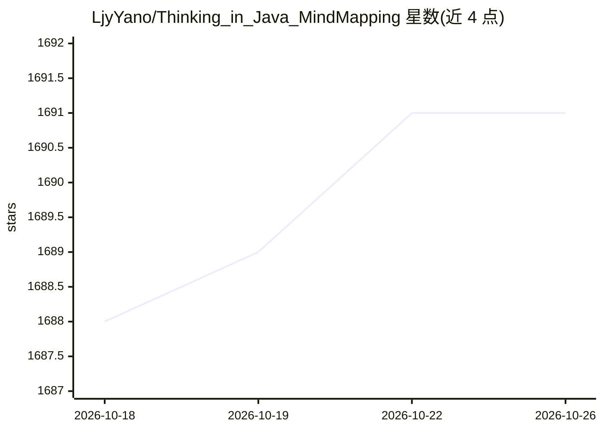

# LjyYano/Thinking_in_Java_MindMapping

⭐ 1,691 · Python · 推送 2026-08-18 · [GitHub](https://github.com/LjyYano/Thinking_in_Java_MindMapping) · [官网](https://yano-nankai.notion.site/Yano-Space-ff42bde7acd1467eb3ae63dc0d4a9f8c) · 个人维护 · 中文 README

**个人知识库：编程、AI、书影音与生活笔记的长期沉淀仓库**

个人笔记仓库，起源于《Java 编程思想》阅读，内容从 Java/JVM/Redis/Netty/Spring 源码分析扩展到 Agent、MCP 等 AI 主题，并覆盖读书、观影、游戏与随笔。文章导航由脚本自动生成（本地 python 脚本或 CI 自动更新），另延伸一个面向 Claude Code 等 AI 编程助手的 skill-pack 项目。内容以 Markdown 文章形式组织，含思维导图系列。

## 筛选速览

| 维度 | 判定 | 备注 |
|---|---|---|
| AI 角色 | `ai-knowledge` | 知识聚合/清单类 |
| 许可风险 | `none` | — |
| 部署形态 | `None` |  |
| 模型依赖 | — | README 未给出锁定关系 |
| 硬件要求 | — | 无带数字的原话,不猜 |
| 安装摩擦 | `medium` | 含编译或系统依赖之一 |
| 成熟度 | — | 结构信号不足 |

## 能力要点

- Java/Redis/Spring/Netty 源码分析与 JDK 新特性系列笔记
- AI 板块覆盖 Agent 原理、MCP 原理与 AI 论文资料
- 文章导航由脚本与 CI 自动生成更新
- 含思维导图系列与读书、观影、游戏等生活记录

## 适用场景

- 系统学习 Java、JVM、Redis、Spring 等后端技术
- 了解 Agent、MCP 等 AI 主题的中文笔记
- 查找技术类思维导图与读书观影记录

## 场景标签

`知识库管理` `教程课程` · 领域:知识与检索

## 证据(README 行号)

> L3: ### 在代码、书影音与生活之间，持续构建自己的知识地图
> L37: 最初，我只是把读书时整理的思维导图截图发布到简书；收到许多读者留言后，便创建了这个项目，将完整笔记持续沉淀下来。后来内容逐渐越过了 Java 的边界，从编程与源码分析，延伸到 AI、读书、观影、游戏和生活随笔。
> L23:  关注 Agent、MCP、AI 论文，以及可视化知识体系。

## 星数曲线

2026-10-18 1,688 → 2026-10-26 1,691（+3）

---
*卡片 v1 · prompt 1.4 · 生成 2026-10-21 · 置信度 high · 依据 README sha `d2c346dd4123` · [字段定义](../../DATASET.md)*
