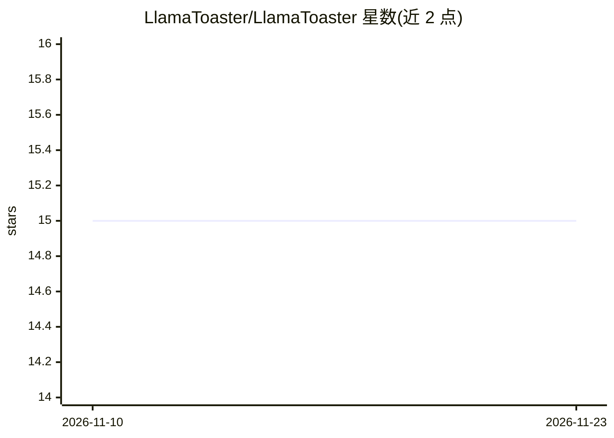

# LlamaToaster/LlamaToaster

⭐ 15 · TypeScript · MIT · 推送 2026-11-21 · [GitHub](https://github.com/LlamaToaster/LlamaToaster) · [官网](https://llamatoaster.com) · 组织维护

**在自有硬件上实测 GGUF/llama.cpp 性能与可行性的基准平台**

由 server（Fastify+SQLite）、client/admin SPA 与 worker 组成的自托管基准系统：worker 长轮询拉取任务，在本机运行 llama-bench/llama-server，测量 prefill/生成速度并扫描上下文×层数×flash attention×K/V cache 类型组合。下载前仅拉取 GGUF 头部（10–15MB）稀疏填充后用 llama-fit-params 判断能否运行；约 400 万 GGUF 文件按 sha256 索引。测试结果上传共享数据库，可用托管实例 llamatoaster.com 或完全离线自部署。支持 llama.cpp 全部后端（CPU/Vulkan/CUDA/ROCm/SYCL/OpenVINO/Metal），并提供读数的 AI 助手面板（需自配 API key）。

## 筛选速览

| 维度 | 判定 | 备注 |
|---|---|---|
| AI 角色 | `ai-ecosystem` | LLM/agent 周边工具 |
| 许可风险 | `permissive` | MIT |
| 部署形态 | `library` | 以包/库形式分发 |
| 模型依赖 | local-ok | 支持本地模型 |
| 硬件要求 | — | 无带数字的原话,不猜 |
| 安装摩擦 | `medium` | 含编译或系统依赖之一 |
| 成熟度 | `idea` | |

## 能力要点

- 仅下载 GGUF 头部（10–15MB）即可预测模型能否在本机运行
- prefill/生成分开实测，扫描上下文×层数×flash attention×64 种 K/V cache 组合
- 约 400 万 GGUF 文件按 sha256 索引，同名不同源文件不重复
- worker 仅出站 HTTPS 长轮询，无需端口转发；可自托管或接入共享结果库

## 适用场景

- 下载 20–30GB 模型前确认我的显存/内存够不够
- 为我的 GPU/CPU 找到最优 llama-server 启动参数
- 把本机实测性能汇入共享数据库，与全网数据对比
- 为 agent 提供带 VRAM/RAM 监控的 OpenAI 兼容本地推理端点

## 场景标签

`模型评测` `推理引擎` · 领域:评测与运维

## 证据(README 行号)

> L28: |How many tokens per second will I really get, in prefill and in generation?|**New test**: a real `llama-server` ru
> L52: LlamaToaster runs on your machine, with your build, on the model you picked. Prefill
> L168: worker/   runs on each benchmark box: long-polls the server, spawns llama-bench/llama-server

## 星数曲线

2026-11-10 15 → 2026-11-23 15（+0）

---
*卡片 v1 · prompt 1.4 · 生成 2026-11-18 · 置信度 high · 依据 README sha `b281b58d0d33` · [字段定义](../../DATASET.md)*
