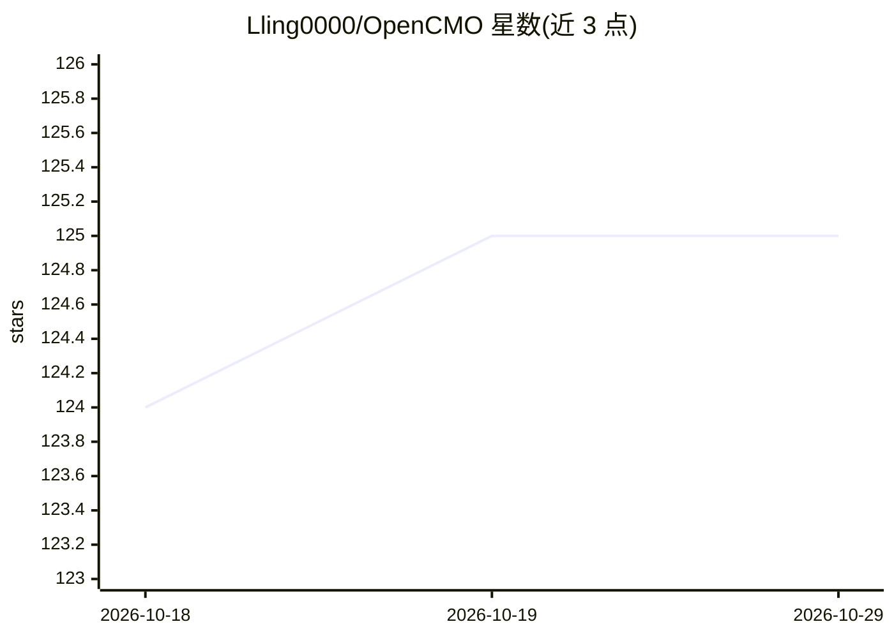

# Lling0000/OpenCMO

⭐ 125 · Python · 推送 2026-10-13 · [GitHub](https://github.com/Lling0000/OpenCMO) · [官网](https://www.aidcmo.com/) · 个人维护 · 中文 README

**自托管多 agent AI 首席营销官：搜索可见性与增长分析工作台**

面向创始人、开源维护者和小型产品团队的自托管 AI CMO：从产品 URL 出发构建项目上下文，采集 SEO、AI 搜索可见性（GEO）、社区与竞品信号，由专家 agent 生成报告、内容草稿与优先级建议，支持定时扫描与发布审批队列。BYOK 模式，配置 OpenAI 或 OpenAI 兼容端点（需支持工具调用的模型）。RAG 知识库采用 Qdrant 稠密检索+BM25+重排，输出带来源引用。技术栈为 React 19 前端 + FastAPI/OpenAI Agents SDK 后端 + Crawl4AI 采集，Docker Compose 或源码运行。

## 筛选速览

| 维度 | 判定 | 备注 |
|---|---|---|
| AI 角色 | `ai-native` | 本体是模型或模型工具 |
| 许可风险 | `none` | — |
| 部署形态 | `self-host` | docker 或自建部署 |
| 模型依赖 | — | README 未给出锁定关系 |
| 硬件要求 | — | 无带数字的原话,不猜 |
| 安装摩擦 | `low` | 无编译、无系统依赖或容器化 |
| 成熟度 | — | 结构信号不足 |

## 能力要点

- 从单一 URL 构建项目上下文并多阶段监控流水线（采集→规范化→领域审查→策略综合）
- SEO 审计、AI 搜索可见性（GEO）、社区与竞品知识图谱
- RAG 知识库：Qdrant+BM25+多路召回与重排，输出带来源引用
- 审批队列控制发布决策，支持 Reddit 与 Twitter/X 直接发布

## 适用场景

- 跟踪自家产品在搜索与 AI 搜索中的可见性与品牌提及
- 汇总社区讨论与竞品动态生成增长建议报告
- 基于自有文档生成有据可依的营销内容草稿

## 场景标签

`多智能体` `RAG` `数据分析` `AI 写作` · 领域:Agent 开发

## 证据(README 行号)

> L19: OpenCMO is a self-hosted AI Chief Marketing Officer for founders, open-source maintainers and small product teams. 
> L29: |**Reports & AI chat**|Generate strategic reports and weekly summaries, get a Human Readout and Agent Brief, or dis
> L32: **Bring your own model.** Configure OpenAI or an OpenAI-compatible endpoint, a model with tool-calling support, and

## 星数曲线

2026-10-18 124 → 2026-10-29 125（+1）

---
*卡片 v1 · prompt 1.4 · 生成 2026-10-23 · 置信度 mid · 依据 README sha `2f464b122673` · [字段定义](../../DATASET.md)*
