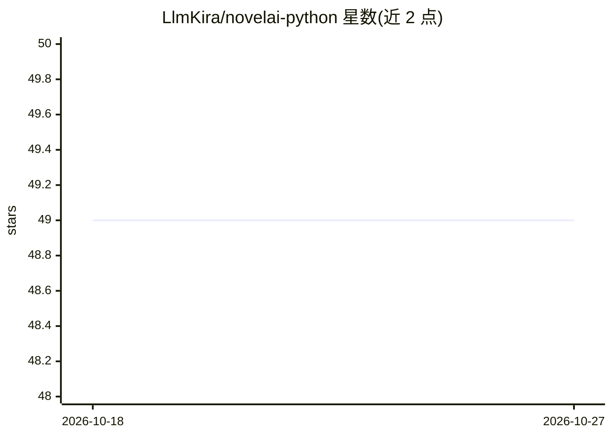

# LlmKira/novelai-python

⭐ 49 · Python · Apache-2.0 · 推送 2026-10-24 · [GitHub](https://github.com/LlmKira/novelai-python) · [官网](https://novelai.net) · 个人维护

**访问 NovelAI API 的异步 Python SDK（图像/文本/语音）**

基于 Pydantic 构造合法请求、访问 NovelAI API 服务的第三方 Python SDK，要求 Python ≥ 3.12。覆盖 Diffusion V4.5/V5 图像生成（含流式中间预览、角色参考、透明背景、放大）、OpenAI 兼容文本 API、订阅与 Anlas 额度查询、持久令牌创建等。依赖 pydantic、curl_cffi、kitoken 等库，请求模拟 Chrome 浏览器指纹；提供可选的本地图像限额、请求间隔控制（RequestPacer）与 Prometheus/VictoriaMetrics 指标扩展。作者声明与 NovelAI 无关，项目处于非活跃维护状态，问题通过 issue 提出。

## 筛选速览

| 维度 | 判定 | 备注 |
|---|---|---|
| AI 角色 | `ai-ecosystem` | LLM/agent 周边工具 |
| 许可风险 | `permissive` | Apache-2.0 |
| 部署形态 | `library` | 以包/库形式分发 |
| 模型依赖 | — | README 未给出锁定关系 |
| 硬件要求 | — | 无带数字的原话,不猜 |
| 安装摩擦 | `low` | 无编译、无系统依赖或容器化 |
| 成熟度 | — | 结构信号不足 |

## 能力要点

- Pydantic 构造请求，支持 Diffusion V5 全系模型与流式生成预览
- 可选 Prometheus/VictoriaMetrics 指标扩展（请求计数、Anlas/Opus 用量仪表）
- 本地图像限额与 RequestPacer 请求间隔控制
- OpenAI 兼容文本 API（/oa/v1）与持久 API 令牌创建

## 适用场景

- 在 Python 项目中调用 NovelAI 的图像/文本生成 API
- 监控 NovelAI 账户的 Anlas 与 Opus 用量
- 为批量生成任务做限额与请求节奏控制

## 场景标签

`图像生成` · 领域:内容生成

## 证据(README 行号)

> L17: ✨ NovelAI api python sdk with Pydantic, modern and user-friendly.
> L19: The goal of this repository is to use Pydantic to build legitimate requests to access
> L20: the NovelAI API service.

## 星数曲线

2026-10-18 49 → 2026-10-27 49（+0）

---
*卡片 v1 · prompt 1.4 · 生成 2026-10-24 · 置信度 high · 依据 README sha `e7a7621625f3` · [字段定义](../../DATASET.md)*
