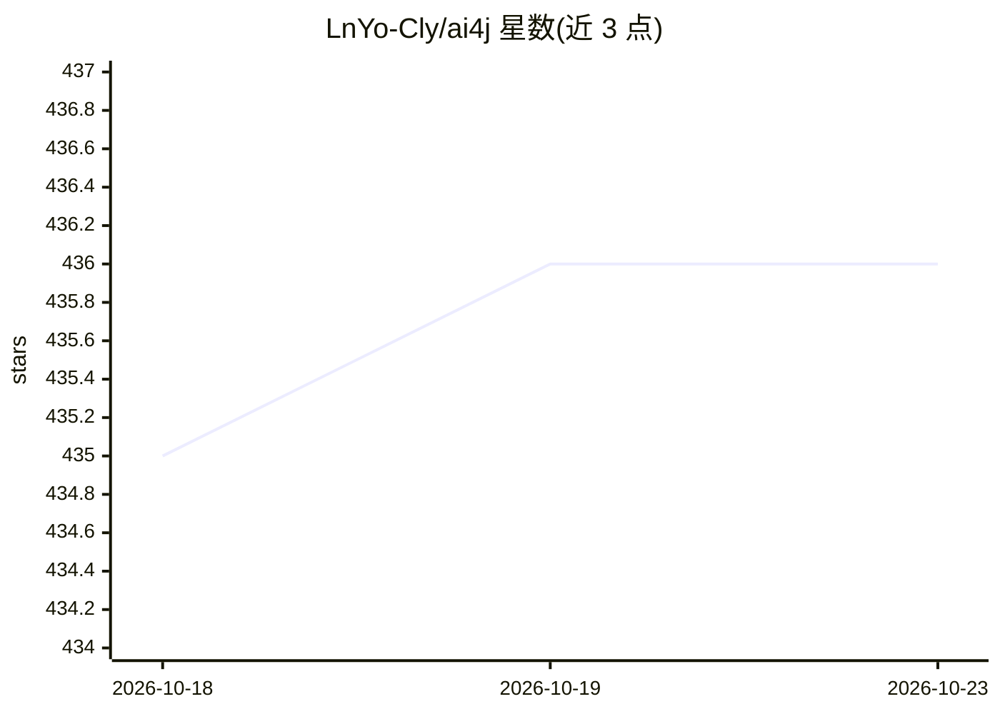

# LnYo-Cly/ai4j

⭐ 436 · Java · Apache-2.0 · 推送 2026-10-13 · [GitHub](https://github.com/LnYo-Cly/ai4j) · [官网](https://lnyo-cly.github.io/ai4j/) · 个人维护 · 中文 README

**面向 JDK 8+ 的 Java AI Agentic 开发套件**

面向 Java 开发者的 Agentic SDK：以统一工厂接入 OpenAI、Anthropic、DashScope、DeepSeek、Ollama 等 12+ 模型平台，支持 Chat/Responses/Messages 三套协议与 Function Calling；内置 RAG 全链路（文档加载、八大向量库适配、混合检索、重排）、MCP 客户端/服务端、A2A、Skill 与插件体系。提供 ReAct/CodeAct/Deep Research 三种执行模式与 StateGraph 图编排；ai4j-harness 将 Agent 转变为可暂停恢复、需验收的长期任务。附带开箱即用的 Coding Agent（CLI/TUI/ACP）。通过 Gradle/Maven 引入，CLI 另有安装脚本，需 Java 8+。

## 筛选速览

| 维度 | 判定 | 备注 |
|---|---|---|
| AI 角色 | `ai-ecosystem` | LLM/agent 周边工具 |
| 许可风险 | `permissive` | Apache-2.0 |
| 部署形态 | `None` |  |
| 模型依赖 | local-ok | 支持本地模型 |
| 硬件要求 | — | 无带数字的原话,不猜 |
| 安装摩擦 | `medium` | 含编译或系统依赖之一 |
| 成熟度 | — | 结构信号不足 |

## 能力要点

- 统一工厂接入 12+ 模型平台，切换平台仅需修改 PlatformType
- 内置 RAG 全链路：加载、切块、八大向量库适配、混合检索、重排、引用标注
- ai4j-harness：任务持久化、断点恢复、租约并行、验收门禁与审计台账
- 内置 Coding Agent，提供 CLI / TUI / ACP 三种入口，可作依赖扩展

## 适用场景

- 在 Java 8+ 项目中统一接入多家大模型平台构建 Agent
- 搭建带 RAG 检索与 MCP 工具调用的多智能体应用
- 把长链路业务编排为可暂停、可恢复、需人工验收的长期任务
- 基于 CLI/TUI/ACP 快速获得本地 Coding Agent

## 场景标签

`Agent 框架` `多智能体` `RAG` `编码 Agent` · 领域:Agent 开发

## 证据(README 行号)

> L17: 面向 **JDK 8+** 的 Java AI Agentic 开发套件：统一接入主流大模型服务，内置从工具调用、RAG、MCP、Skill、沙箱到 Agent 编排与长时任务治理的完整能力，支撑快速构建专属的 Agent 与 H
> L23: - **统一接入 12+ 模型平台**：OpenAI、Anthropic、DeepSeek、智谱、豆包、Ollama 等由同一工厂提供服务；Chat / Responses / Messages 三套协议完整支持，Function

## 星数曲线

2026-10-18 435 → 2026-10-23 436（+1）

---
*卡片 v1 · prompt 1.4 · 生成 2026-10-21 · 置信度 high · 依据 README sha `0874b9e015ff` · [字段定义](../../DATASET.md)*
