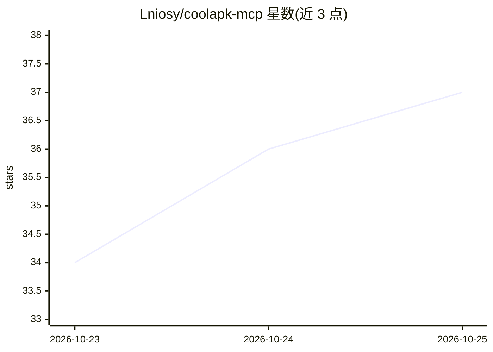

# Lniosy/coolapk-mcp

⭐ 39 · Python · MIT · 推送 2026-10-22 · [GitHub](https://github.com/Lniosy/coolapk-mcp) · 个人维护 · 中文 README

**酷安社区的 MCP Server + CLI，供 AI 助手检索社区内容**

把酷安社区封装为 MCP Server 与 CLI 两种形式：MCP 路径供 Cursor / Claude Desktop / Claude Code 接入，注册 coolapk_search、coolapk_feed_detail 等 6 个工具；CLI 路径输出紧凑 JSON，适合脚本与管道调用。功能覆盖帖子/用户/话题/应用搜索、首页动态、话题浏览，点赞/回复/关注需 Cookie 登录。通过 Token 生成与设备标识模拟访问公开 API，Pydantic 精简序列化将输出压缩至原始响应约 10%。已知限制：帖子详情接口在部分环境触发验证码，搜索等读接口通常可用。个人/研究向，MIT 开源。

## 筛选速览

| 维度 | 判定 | 备注 |
|---|---|---|
| AI 角色 | `ai-ecosystem` | LLM/agent 周边工具 |
| 许可风险 | `permissive` | MIT |
| 部署形态 | `library` | 以包/库形式分发 |
| 模型依赖 | locked-api |  |
| 硬件要求 | — | 无带数字的原话,不猜 |
| 安装摩擦 | `low` | 无编译、无系统依赖或容器化 |
| 成熟度 | — | 结构信号不足 |

## 能力要点

- MCP Server 注册 6 个工具 + CLI 双形态输出紧凑 JSON
- 搜索/帖子详情/用户资料/首页动态/话题浏览，交互操作需登录
- Pydantic 精简序列化，输出约为原始响应 10%
- 内置 Claude Code Skill（.claude/skills/coolapk.md）

## 适用场景

- 在 Cursor / Claude 里直接搜索和拉取酷安帖子、热榜与应用信息
- 用 CLI 在脚本或 Agent 流程中批量检索酷安内容
- 登录后执行点赞、回复、关注等交互操作

## 场景标签

 · 领域:社区数据/LLM 工具接入

## 证据(README 行号)

> L22: `coolapk-mcp` 把酷安社区做成 **MCP Server + CLI**，让 AI 编程助手能：
> L45: 1. **MCP Server**（推荐接 Cursor / Claude Desktop）

## 星数曲线

2026-10-23 34 → 2026-10-25 37（+3）

---
*卡片 v1 · prompt 1.4 · 生成 2026-10-25 · 置信度 high · 依据 README sha `8ee9d28ec708` · [字段定义](../../DATASET.md)*
