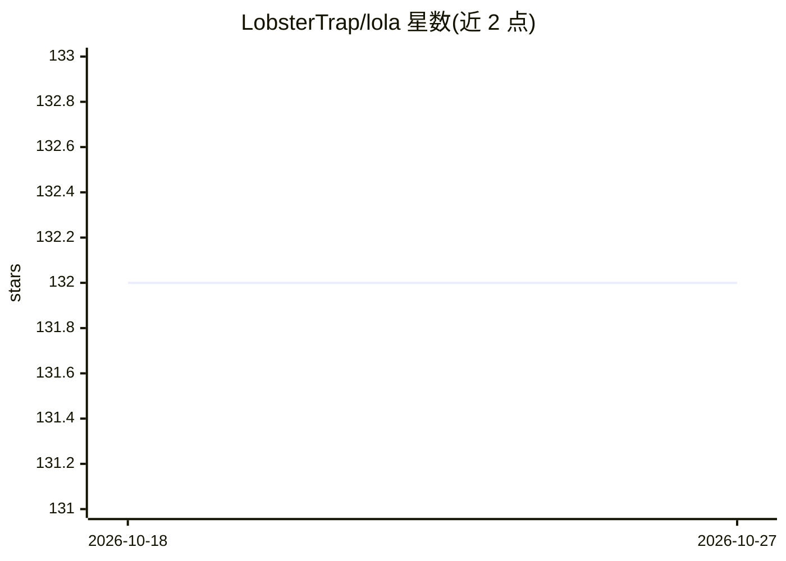

# LobsterTrap/lola

⭐ 132 · Python · Apache-2.0 · 推送 2026-10-14 · [GitHub](https://github.com/LobsterTrap/lola) · [官网](https://getlola.dev/) · 组织维护

**面向 AI 助手的技能/上下文包管理器，一次编写多处安装**

Lola 是将 Agent 技能与上下文模块打包为可移植包并安装到多个 AI 助手的通用包管理器，自比'技能界的 DNF'。支持 Claude Code、Copilot CLI、Copilot (VS Code)、Cursor、Gemini CLI、OpenCode 六类助手，安装时把 skills/commands/agents 转换为各助手原生格式，含路径重写与模块名前缀防冲突。提供 marketplace 目录注册/搜索/安装、声明式 .lola-req 依赖同步、项目/用户两种安装范围。通过 PyPI/uv/pip 安装，Apache-2.0 许可，由 LobsterTrap 维护者治理。

## 筛选速览

| 维度 | 判定 | 备注 |
|---|---|---|
| AI 角色 | `ai-ecosystem` | LLM/agent 周边工具 |
| 许可风险 | `permissive` | Apache-2.0 |
| 部署形态 | `library` | 以包/库形式分发 |
| 模型依赖 | locked-api |  |
| 硬件要求 | — | 无带数字的原话,不猜 |
| 安装摩擦 | `low` | 无编译、无系统依赖或容器化 |
| 成熟度 | — | 结构信号不足 |

## 能力要点

- 一次编写的技能/上下文包可安装到 6 类 AI 助手（Claude Code/Copilot/Cursor/Gemini CLI/OpenCode）
- 安装时自动转换为各助手原生格式（含路径重写与模块名前缀防冲突）
- marketplace 目录机制：注册 YAML 目录、搜索、安装、缓存更新
- 声明式 .lola-req 依赖文件 + lola sync；支持项目与用户两种安装范围

## 适用场景

- 把团队编写的 Agent 技能统一分发到不同 AI 编程助手中
- 通过 marketplace 搜索并安装社区技能模块
- 在项目里用声明式文件管理 AI 技能依赖

## 场景标签

`提示工程` · 领域:Agent 开发

## 证据(README 行号)

> L8: Lola is a universal AI Package Manager. If an agent's skills were an RPM, Lola is the DNF for it. Write your skills 
> L14: |Assistant|Skills|Commands|Agents|

## 星数曲线

2026-10-18 132 → 2026-10-27 132（+0）

---
*卡片 v1 · prompt 1.4 · 生成 2026-10-22 · 置信度 high · 依据 README sha `7987c86f8f9c` · [字段定义](../../DATASET.md)*
