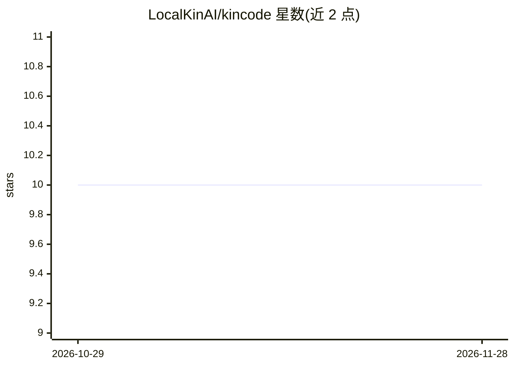

# LocalKinAI/kincode

⭐ 10 · Go · MIT · 推送 2026-09-17 · [GitHub](https://github.com/LocalKinAI/kincode) · 组织维护

**Go 编写的终端 AI 编码助手：单二进制、零依赖**

面向开发者的终端 CLI 编码助手，以 Go 编写并编译为约 9-10MB 的单一二进制。提供 14 个内置工具（bash、文件读写、grep、git、web_search 等）、命名子代理、MCP 工具服务器接入、Soul 文件自定义人格与 provider/model 切换、审批门控权限系统、编辑后自动编译验证、undo、计划模式、上下文压缩与会话持久化。可通过 Claude 账号登录免 API key 使用，也支持 -serve 模式以 HTTP+SSE 暴露接口供桌面壳集成。

## 筛选速览

| 维度 | 判定 | 备注 |
|---|---|---|
| AI 角色 | `ai-native` | 本体是模型或模型工具 |
| 许可风险 | `permissive` | MIT |
| 部署形态 | `library` | 以包/库形式分发 |
| 模型依赖 | local-ok | 支持本地模型 |
| 硬件要求 | — | 无带数字的原话,不猜 |
| 安装摩擦 | `low` | 无编译、无系统依赖或容器化 |
| 成熟度 | — | 结构信号不足 |

## 能力要点

- 单二进制约 10MB、零运行时依赖
- 14 个内置工具 + 命名子代理 + MCP 工具服务器接入
- Soul 文件切换人格与 provider/model，兼容 kinclaw 内核格式
- 审批门控：bash 规则按 shell 拆分逐条命令检查

## 适用场景

- 在终端里让 AI 代理读写代码、跑命令并自动编译验证
- 通过 Soul 文件为不同项目配置不同人格与模型
- 以 -serve 守护进程方式供桌面客户端驱动编码会话
- 用 Claude 账号登录、无需 API key 直接使用

## 场景标签

`编码 Agent` · 领域:编码与开发

## 证据(README 行号)

> L3: A lightweight AI coding assistant for your terminal. Written in Go. Single binary. Zero dependencies.
> L10: - Multi-provider: Anthropic, OpenAI, Ollama (any OpenAI-compatible endpoint)
> L11: - **14 built-in tools**: bash, bash_output, file_read / file_write / file_edit / multi_edit, glob, grep, git, web_f

## 星数曲线

2026-10-29 10 → 2026-11-28 10（+0）

---
*卡片 v1 · prompt 1.4 · 生成 2026-11-20 · 置信度 mid · 依据 README sha `fc7ef763c546` · [字段定义](../../DATASET.md)*
