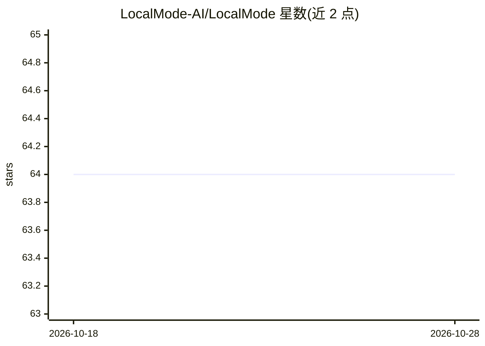

# LocalMode-AI/LocalMode

⭐ 64 · TypeScript · MIT · 推送 2026-10-28 · [GitHub](https://github.com/LocalMode-AI/LocalMode) · [官网](https://localmode.ai) · 组织维护

**面向前端的浏览器本地 AI 工具包：离线运行模型构建隐私优先应用**

monorepo 形式提供 16 个 npm 包与 shadcn 风格 UI 注册表（107 个组件、37 个 blocks），支持在浏览器内运行嵌入、向量检索（HNSW）、流式 LLM 对话、结构化输出、Agent（ReAct + 工具审批）、视觉/音频/多模态等能力。模型推理通过 Transformers.js、WebLLM、wllama、Chrome 内置 AI 等多个 provider 实现，模型下载后完全离线运行，无需服务器与 API key。面向用 React/Next.js 构建 Web AI 应用的开发者。

## 筛选速览

| 维度 | 判定 | 备注 |
|---|---|---|
| AI 角色 | `ai-ecosystem` | LLM/agent 周边工具 |
| 许可风险 | `permissive` | MIT |
| 部署形态 | `library` | 以包/库形式分发 |
| 模型依赖 | local-ok | 支持本地模型 |
| 硬件要求 | — | 无带数字的原话,不猜 |
| 安装摩擦 | `low` | 无编译、无系统依赖或容器化 |
| 成熟度 | `idea` | |

## 能力要点

- 16 个 npm 包覆盖嵌入、RAG、LLM 对话、Agent、评测、观测等能力
- 四类 LLM provider（WebLLM/wllama/Transformers.js/Chrome 内置 AI）实现同一 LanguageModel 接口并支持回退
- HNSW 向量库带 WebGPU 搜索与 SQ8/PQ 量化，数据不离设备
- 107 个 UI 组件 + 37 个可运行 blocks，经 shadcn CLI 安装并拥有拷贝代码

## 适用场景

- 构建完全在浏览器运行、无需后端的隐私优先 AI 应用
- 为现有 React 应用加入离线语义搜索与 RAG 问答
- 通过统一接口在多家本地模型 provider 之间切换与回退
- 用现成 UI blocks 快速搭建聊天、语音转写、目标检测等 demo

## 场景标签

`RAG` `语义搜索` `语音识别` `Agent 框架` · 领域:Agent 开发

## 证据(README 行号)

> L22: LocalMode is a monorepo of packages for building AI-powered applications that run 100% in the browser. Everything f
> L33: - **Interoperable** -- Vercel AI SDK patterns. LangChain.js adapters. Import from Pinecone/ChromaDB.
> L41: |`@localmode/ai-sdk`|npm|Vercel AI SDK provider for local models|

## 星数曲线

2026-10-18 64 → 2026-10-28 64（+0）

---
*卡片 v1 · prompt 1.4 · 生成 2026-10-24 · 置信度 high · 依据 README sha `513573438534` · [字段定义](../../DATASET.md)*
