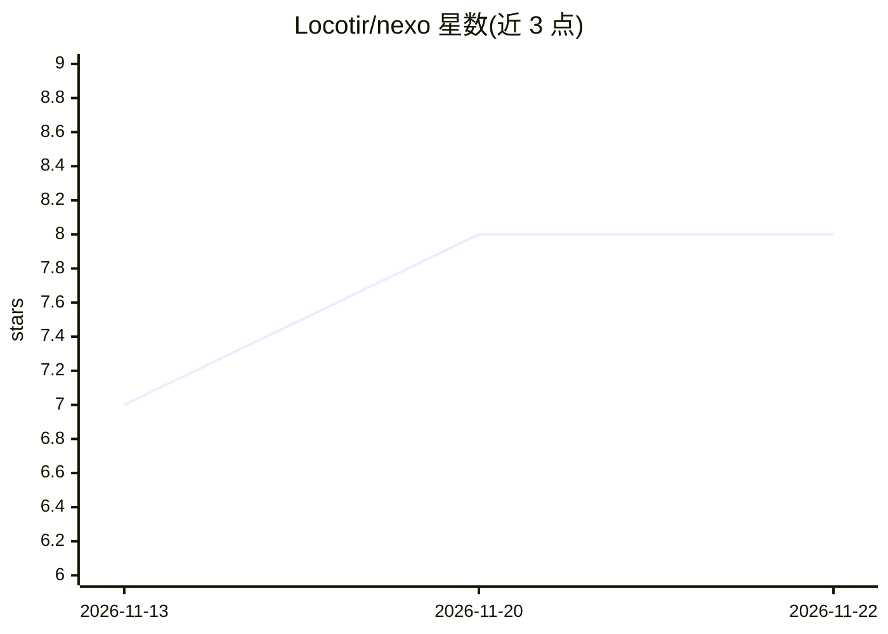

# Locotir/nexo

⭐ 8 · Rust · Apache-2.0 · 推送 2026-11-21 · [GitHub](https://github.com/Locotir/nexo) · 个人维护

**面向开发者的 Rust 终端编码 agent，长会话上下文不溢出**

用 Rust 编写的终端编码 agent，接入任意模型供应商；其上下文策展器（curator）把完整历史保留在磁盘上，每步只发送该步所需的内容视图，不做压缩与摘要，并保持供应商提示缓存命中。可全屏 TUI、无头脚本/CI 或经 ACP 嵌入编辑器运行；支持写前 diff、权限规则、undo/rewind、子 agent、hooks、MCP 服务器等工具能力。提供 Linux/macOS/Windows 安装脚本与 cargo 源码安装，内置逆向工程套件 nexo RE（反汇编/调试）。README 含与其他 harness 的自测对比数据。

## 筛选速览

| 维度 | 判定 | 备注 |
|---|---|---|
| AI 角色 | `ai-native` | 本体是模型或模型工具 |
| 许可风险 | `permissive` | Apache-2.0 |
| 部署形态 | `library` | 以包/库形式分发 |
| 模型依赖 | local-ok | 支持本地模型 |
| 硬件要求 | — | 无带数字的原话,不猜 |
| 安装摩擦 | `low` | 无编译、无系统依赖或容器化 |
| 成熟度 | — | 结构信号不足 |

## 能力要点

- 上下文策展器：历史留盘、按步构建视图，无摘要压缩
- 支持 TUI、headless/CI、编辑器内 ACP 三种运行方式
- 内置 218 个供应商目录，兼容 OpenAI/Anthropic 端点与本地服务器
- nexo RE：内置反汇编器、反编译器与调试器，经 --mcp 可供其他 agent 使用

## 适用场景

- 在终端内进行长会话的代码修复与重构，避免上下文被摘要丢失
- 在 CI/脚本中无头运行编码 agent
- 用自然语言分析调试自己编译的程序

## 场景标签

`编码 Agent` · 领域:编码与开发

## 证据(README 行号)

> L26: nexo is a terminal coding agent written in Rust, for any model provider. Its context curator keeps long sessions
> L27: small without summaries: the whole history stays on disk, and the model is sent only what the next step needs.
> L161: Fireworks, Cerebras, Moonshot, Qwen, Zhipu, MiniMax, and local servers (Ollama, LM Studio, vLLM, llama.cpp). A bui

## 星数曲线

2026-11-13 7 → 2026-11-22 8（+1）

---
*卡片 v1 · prompt 1.4 · 生成 2026-11-20 · 置信度 high · 依据 README sha `d754b6a47ef2` · [字段定义](../../DATASET.md)*
