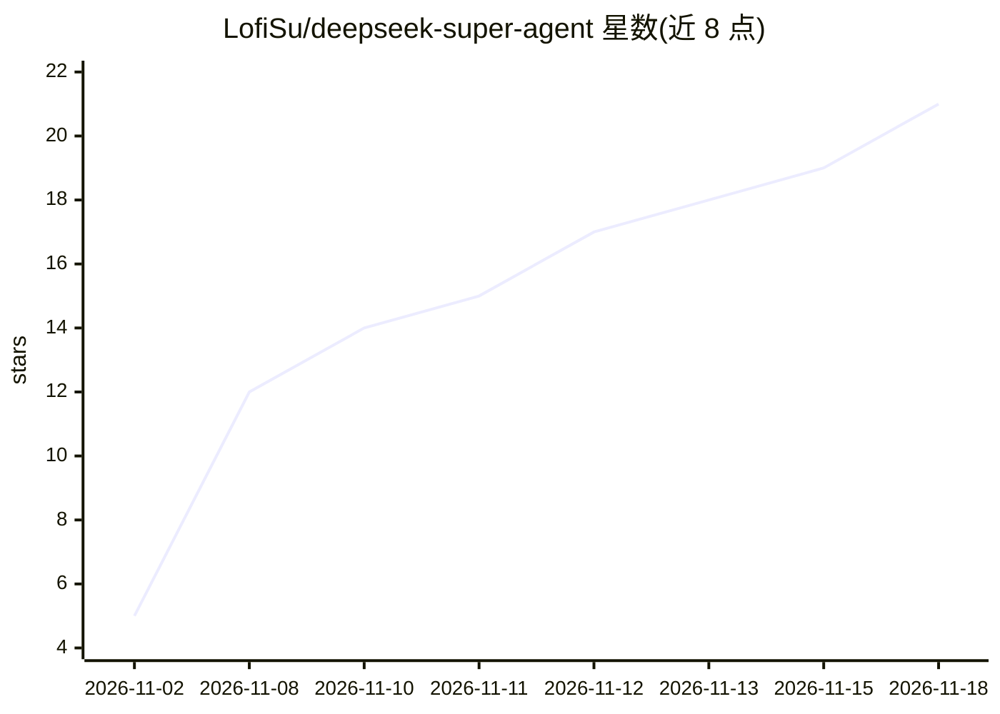

# LofiSu/deepseek-super-agent

⭐ — · [GitHub]() · 个人维护 · 中文 README

**TypeScript 个人 Agent 运行时：Router/Worker 双角色与触发驱动**

MIT 许可的独立开源项目（非 DeepSeek 官方产品），用 TypeScript/Node.js 22+ 实现异步 ReAct 运行时与主动式领域引擎。上层包含 Router/Worker 双角色、Triggers、Threads、Eval、Tickets、Watchdog 模块；模型调用走任意 OpenAI 兼容 API（可直接指向 DeepSeek）。支持 GitHub/Feishu/iMessage 等渠道接入、SQLite 持久化重启恢复、沙箱化 bash 执行、审批与例行任务机制。面向想自建长期运行个人 Agent 的开发者，通过 git clone + pnpm 从源码运行，未发布到 npm。

## 筛选速览

| 维度 | 判定 | 备注 |
|---|---|---|
| AI 角色 | `ai-ecosystem` | LLM/agent 周边工具 |
| 许可风险 | `permissive` | — |
| 部署形态 | `library` | 以包/库形式分发 |
| 模型依赖 | locked-api |  |
| 硬件要求 | — | 无带数字的原话,不猜 |
| 安装摩擦 | `low` | 无编译、无系统依赖或容器化 |
| 成熟度 | — | 结构信号不足 |

## 能力要点

- Router/Worker 双角色架构，Worker 会话无法回复或决策，仅 Router 写入渠道
- Triggers 驱动循环，规则 Fast Path 默认、模型 Slow Path 可选并带回退
- SQLite 持久化，重启可恢复；Watchdog 位于控制路径之外
- bash 调用强制经 sandbox-exec/bwrap 沙箱包装，缺沙箱即硬错误

## 适用场景

- 搭建长期运行、可接收 GitHub/飞书/iMessage 触发的个人 Agent
- 通过审批机制让 Agent 执行外向操作前经我确认
- 运行跨重启的长任务与定时例行任务

## 场景标签

`Agent 框架` · 领域:Agent 开发

## 证据(README 行号)

> L14: A thin async ReAct runtime at the bottom. A proactive domain engine on top:
> L104: - **Harness.** A session event log, an async ReAct loop, OpenAI-compatible model calls, tools registered by role, 

## 星数曲线

2026-11-02 5 → 2026-11-18 21（+16）

---
*卡片 v1 · prompt 1.4 · 生成 2026-11-18 · 置信度 mid · 依据 README sha `69d24f84e189` · [字段定义](../../DATASET.md)*
