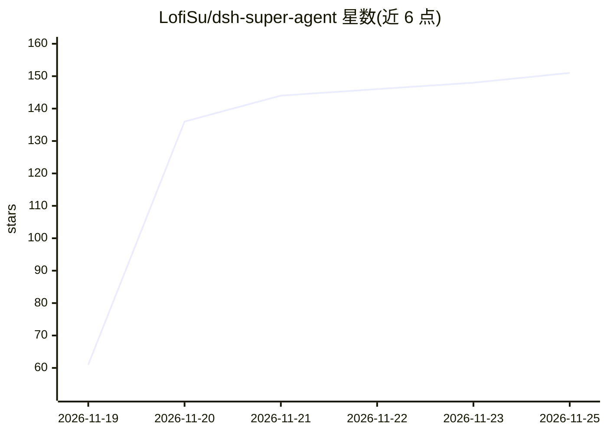

# LofiSu/dsh-super-agent

⭐ 151 · TypeScript · MIT · 推送 2026-11-22 · [GitHub](https://github.com/LofiSu/dsh-super-agent) · 个人维护 · 中文 README

**个人多 Agent 运行时框架：Router/Worker 协作处理主动触发的工作流**

TypeScript 实现的多 Agent 框架，底层为异步 ReAct 运行时，上层是主动式领域引擎（Intake→Eval→Ticket→Assignment→Outbox）。Router 与 Worker 分角色协作，Trigger 驱动循环，Watchdog 在控制路径之外处理卡死任务；状态持久化于 SQLite，重启可恢复。支持 CLI、GitHub、飞书、iMessage 等通道与审批、例程、技能等所有者控制机制。非官方 DeepSeek 项目，未发布到 npm，需从源码运行。

## 筛选速览

| 维度 | 判定 | 备注 |
|---|---|---|
| AI 角色 | `ai-ecosystem` | LLM/agent 周边工具 |
| 许可风险 | `permissive` | MIT |
| 部署形态 | `library` | 以包/库形式分发 |
| 模型依赖 | — | README 未给出锁定关系 |
| 硬件要求 | — | 无带数字的原话,不猜 |
| 安装摩擦 | `low` | 无编译、无系统依赖或容器化 |
| 成熟度 | `idea` | |

## 能力要点

- Router/Worker 两角色架构，Worker 可派生 team 异步聚合报告
- 异步 ReAct：start_job 立即返回，任务完成后以 JOB_DONE 接续对话
- 沙箱执行：macOS 用 sandbox-exec、Linux 用 bwrap 包裹 bash 调用
- 长期记忆混合检索：词法搜索 + 可选嵌入召回，默认离线 HashedEmbedding

## 适用场景

- 让个人 Agent 持续接收入站任务并跨重启保持状态
- 把自包含任务委托给 Claude Code、Codex 等本地 CLI agent 执行
- 通过 GitHub/飞书/iMessage 通道驱动 Agent 日常工作流

## 场景标签

`Agent 框架` `多智能体` · 领域:Agent 开发

## 证据(README 行号)

> L13: A thin async ReAct runtime at the bottom. A proactive domain engine on top:
> L99: Most agent frameworks give you a loop: messages in, tool calls out, repeat. That loop is necessary, but it is not a
> L103: - **Harness.** A session event log, an async ReAct loop, OpenAI-compatible model calls, tools registered by role, 

## 星数曲线

2026-11-19 61 → 2026-11-25 151（+90）

---
*卡片 v1 · prompt 1.4 · 生成 2026-11-20 · 置信度 mid · 依据 README sha `3f3a4b2424c8` · [字段定义](../../DATASET.md)*
