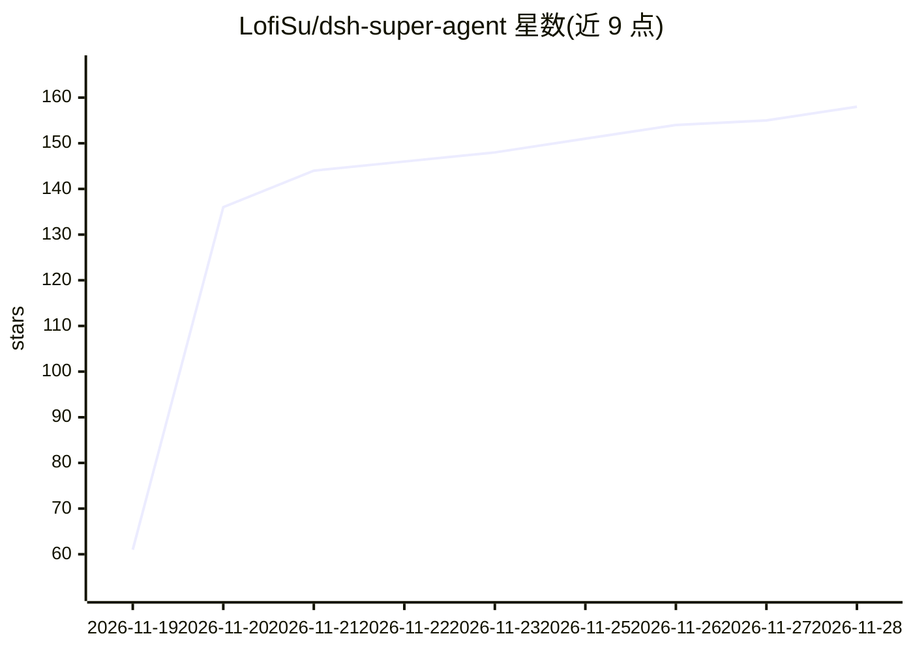

# LofiSu/dsh-super-agent

⭐ 158 · TypeScript · MIT · 推送 2026-11-27 · [GitHub](https://github.com/LofiSu/dsh-super-agent) · 个人维护 · 中文 README

**面向个人开发者的多智能体运行框架（Router/Worker + Watchdog）**

以 TypeScript 编写的多智能体框架，灵感来自 DeepSeek 的一篇博客（声明非官方产品）。底层为异步 ReAct 运行时，上层实现运行模型：触发器进入 Ingress，经确定性 Fast Path 与可选模型 Slow Path 过滤，Router 分发 Ticket 给隔离开的 Worker，Watchdog 在控制路径之外催促或判死卡住的任务。状态持久化于 SQLite，支持暂停/恢复、审批、定时例程、技能文件与 macOS/Linux 沙箱执行。需 Node.js 22+ 与 pnpm，未发布到 npm，从仓库检出以 `pnpm ds-agent` 运行。

## 筛选速览

| 维度 | 判定 | 备注 |
|---|---|---|
| AI 角色 | `ai-ecosystem` | LLM/agent 周边工具 |
| 许可风险 | `permissive` | MIT |
| 部署形态 | `library` | 以包/库形式分发 |
| 模型依赖 | — | README 未给出锁定关系 |
| 硬件要求 | — | 无带数字的原话,不猜 |
| 安装摩擦 | `low` | 无编译、无系统依赖或容器化 |
| 成熟度 | `idea` | |

## 能力要点

- Router/Worker 双角色序列点模型，Worker 在独立会话以全量工具执行
- Watchdog 独立于控制路径，对卡住任务执行催促或判定失败
- 基于 SQLite 的持久化状态，重启后从断点恢复；Ticket 支持暂停/恢复/审批
- Worker 可委托本地 CLI agent（Claude Code、Codex、OpenCode 等）执行自包含任务

## 适用场景

- 为个人工作流搭建一个能响应触发器并长期运行任务的智能体
- 通过 GitHub issue、飞书或 iMessage 渠道接收任务并自动执行
- 需要人工审批节点和可暂停恢复的长时任务编排

## 场景标签

`Agent 框架` `多智能体` · 领域:Agent 开发

## 证据(README 行号)

> L13: A thin async ReAct runtime at the bottom. A proactive domain engine on top:
> L117: - **Harness.** A session event log, an async ReAct loop, OpenAI-compatible model calls, tools registered by role, 
> L120: The Router is the sequence point: it talks to people, batches triggers, and dispatches work. Workers execute in is

## 星数曲线

2026-11-19 61 → 2026-11-28 158（+97）

---
*卡片 v1 · prompt 1.4 · 生成 2026-11-27 · 置信度 mid · 依据 README sha `9c1f94921290` · [字段定义](../../DATASET.md)*
