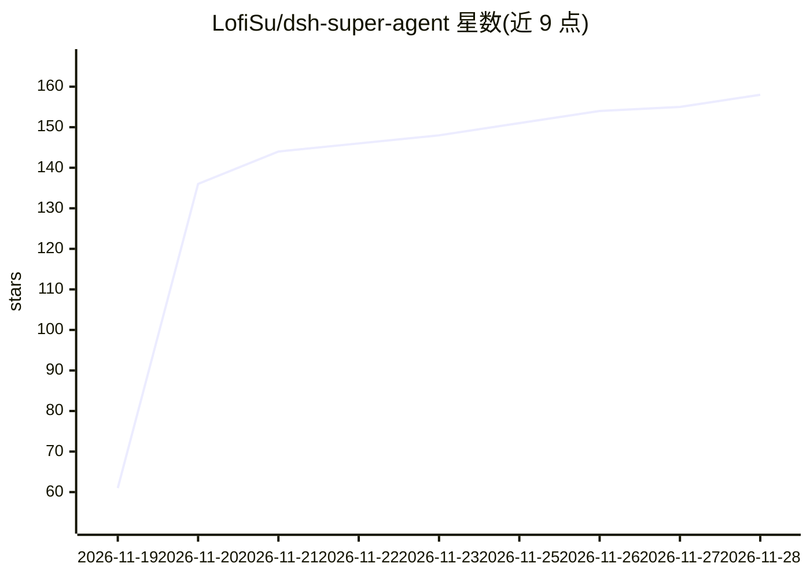

# LofiSu/dsh-super-agent

⭐ 158 · TypeScript · MIT · 推送 2026-11-27 · [GitHub](https://github.com/LofiSu/dsh-super-agent) · 个人维护 · 中文 README

**TypeScript 多智能体框架：Router/Worker、触发器与 Watchdog 运行时**

受 DeepSeek 博客启发的个人开源项目（非官方 DeepSeek 产品），基于 Node.js 22+ 与 pnpm 运行。底层为异步 ReAct 运行时，上层提供 Router/Worker 双角色、Triggers、Threads、Eval、Tickets、Assignments、Outbox 与 Watchdog 等引擎机制；状态持久化在 SQLite，支持任务暂停/恢复、审批卡、定时 Routines、SKILL.md 技能扩展、长任务异步执行、混合检索记忆，以及 CLI/GitHub/飞书/iMessage 等通道。模型侧使用任意 OpenAI 兼容 API，默认提供 DeepSeek 端点预设。仓库未发布到 npm，需从源码检出以 pnpm ds-agent 使用。

## 筛选速览

| 维度 | 判定 | 备注 |
|---|---|---|
| AI 角色 | `ai-ecosystem` | LLM/agent 周边工具 |
| 许可风险 | `permissive` | MIT |
| 部署形态 | `library` | 以包/库形式分发 |
| 模型依赖 | locked-api |  |
| 硬件要求 | — | 无带数字的原话,不猜 |
| 安装摩擦 | `low` | 无编译、无系统依赖或容器化 |
| 成熟度 | `idea` | |

## 能力要点

- Router/Worker 双角色与 Ticket/Assignment/Outbox 工作流引擎
- Watchdog 在控制路径之外处理卡死任务，支持票级暂停/恢复
- OpenAI 兼容 API 接入，附 DeepSeek 端点预设
- macOS sandbox-exec / Linux bwrap 沙箱包裹 Worker bash 调用

## 适用场景

- 让一个常驻 Agent 接收 GitHub/飞书/iMessage 入站事件并分派执行
- 长时间运行编码类任务并跨进程恢复状态
- 需要人工审批卡点后再执行对外动作的自动化流程

## 场景标签

`Agent 框架` `多智能体` · 领域:Agent 开发

## 证据(README 行号)

> L13: A thin async ReAct runtime at the bottom. A proactive domain engine on top:
> L117: - **Harness.** A session event log, an async ReAct loop, OpenAI-compatible model calls, tools registered by role, 
> L52: `ds-agent` speaks any OpenAI-compatible API. Point it at DeepSeek directly:

## 星数曲线

2026-11-19 61 → 2026-11-28 158（+97）

---
*卡片 v1 · prompt 1.4 · 生成 2026-11-28 · 置信度 mid · 依据 README sha `6272ac4f5bed` · [字段定义](../../DATASET.md)*
