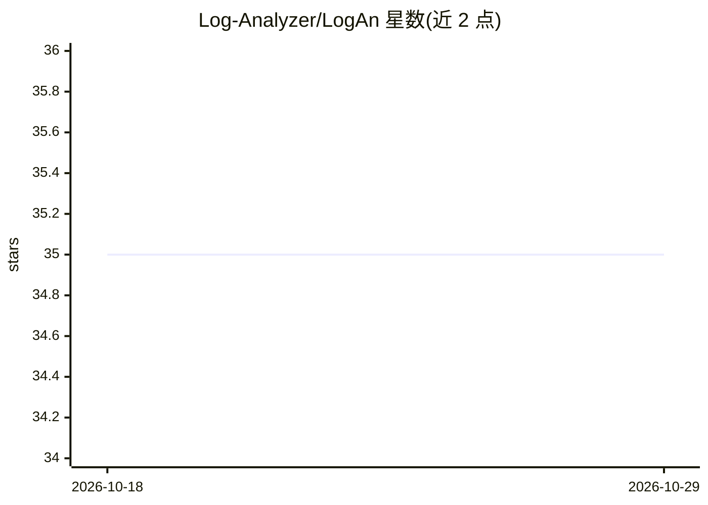

# Log-Analyzer/LogAn

⭐ 35 · JavaScript · Apache-2.0 · 推送 2026-07-30 · [GitHub](https://github.com/Log-Analyzer/LogAn) · 组织维护

**面向 SRE/支持工程师的智能日志分析工具，自动提取问题洞察**

LogAn 读取日志文件，通过 Drain3 将日志行聚类为模板，并使用 NLP/语言模型（zero_shot、similarity 或自定义 HuggingFace 模型，默认 crossencoder）为每个模板预测 golden signals 与故障类别，生成交互式 Log Explorer 报告（侧边栏过滤、时间线、模板下钻、自定义标注），可将数据量缩减至多 90%。面向 SRE、支持工程师与开发者；提供容器镜像、CLI 与查看服务器，另通过 MCP 协议向 Claude Desktop 等 AI agent 暴露 analyze_logs 与 extract_templates 工具。项目由 IBM Research 开发、Red Hat 维护。

## 筛选速览

| 维度 | 判定 | 备注 |
|---|---|---|
| AI 角色 | `ai-native` | 本体是模型或模型工具 |
| 许可风险 | `permissive` | Apache-2.0 |
| 部署形态 | `library` | 以包/库形式分发 |
| 模型依赖 | — | README 未给出锁定关系 |
| 硬件要求 | — | 无带数字的原话,不猜 |
| 安装摩擦 | `low` | 无编译、无系统依赖或容器化 |
| 成熟度 | — | 结构信号不足 |

## 能力要点

- Drain3 模板化聚类，数据量最高减少 90%
- zero_shot/similarity/自定义 HuggingFace 模型预测 golden signals 与故障类别
- JSON 配置的关键词/正则自定义打标机制
- 通过 MCP（stdio/HTTP）向 AI agent 提供 analyze_logs、extract_templates 工具

## 适用场景

- 排查线上故障时快速从海量日志中定位异常模板
- 按组件/严重度等自定义维度对日志分类
- 让 Claude 等 AI agent 通过 MCP 直接调用日志分析能力

## 场景标签

`数据分析` · 领域:效率与自动化

## 证据(README 行号)

> L3: **LogAn** is an intelligent log analysis tool that extracts key insights for SREs/Support Engineers/Developers, to i
> L36: |`LOGAN_MODEL`|`crossencoder`|Model for classification: `bart`, `crossencoder`, or custom HuggingFace model|
> L137: |`analyze_logs`|Run the full analysis pipeline (preprocessing, Drain3 templatization, anomaly detection). Returns 

## 星数曲线

2026-10-18 35 → 2026-10-29 35（+0）

---
*卡片 v1 · prompt 1.4 · 生成 2026-10-25 · 置信度 mid · 依据 README sha `eed2bad8ff4c` · [字段定义](../../DATASET.md)*
