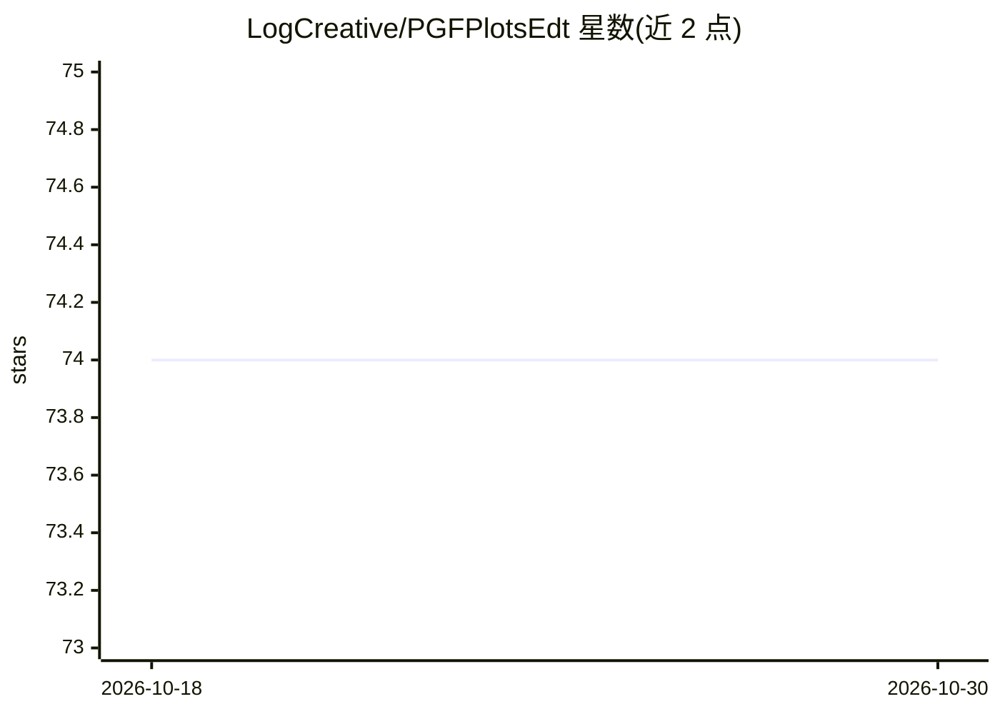

# LogCreative/PGFPlotsEdt

⭐ 74 · JavaScript · AGPL-3.0 · 推送 2026-07-08 · [GitHub](https://github.com/LogCreative/PGFPlotsEdt) · [官网](https://logcreative.github.io/PGFPlotsEdt/) · 个人维护 · 中文 README

**PGFPlots 统计图交互式编辑器，前端自动生成 LaTeX 绘图代码**

基于 Vue.js 的 Web 前端，面向使用 LaTeX PGFPlots 包的用户，通过交互式界面自动生成 PGFPlots 统计图代码，并以 LaTeXOnline 在线编译预览图像、MathJax 预览公式。使用方式包括 GitHub Pages 在线版、本地打开 index.html、本地脚本 ppedt_server.py 近实时编译独立 tex 文件，以及 gunicorn 部署脚本服务多用户。可选运行 ppedt_server_llm.py，通过 Llama 3 或 GLM-4.6（MLC LLM 本地部署或 Cloudflare 无服务器）与 llama-index RAG 实现代码补全。项目隶属 LaTeX Sparkle Project，文档用 l3build 编译。

## 筛选速览

| 维度 | 判定 | 备注 |
|---|---|---|
| AI 角色 | `ai-enhanced` | 去掉 AI 部分产品仍成立 |
| 许可风险 | `viral` | AGPL-3.0 |
| 部署形态 | `None` |  |
| 模型依赖 | — | README 未给出锁定关系 |
| 硬件要求 | — | 无带数字的原话,不猜 |
| 安装摩擦 | `low` | 无编译、无系统依赖或容器化 |
| 成熟度 | — | 结构信号不足 |

## 能力要点

- 交互式界面自动生成 PGFPlots 代码并在线预览编译结果
- ppedt_server.py 本地近实时编译独立 tex 文件
- ppedt_server_llm.py 启用基于 Llama 3/GLM-4.6 的代码补全（MLC LLM 本地或 Cloudflare 部署）
- gunicorn 部署脚本面向多用户生产环境

## 适用场景

- 在 LaTeX 论文中快速绘制统计图并导出 PGFPlots 代码
- 不熟悉 PGFPlots 语法时用图形界面生成绘图代码
- 本地部署以获得更快的编译速度

## 场景标签

`代码生成` `RAG` · 领域:编码与开发

## 证据(README 行号)

> L10: PGFPlotsEdt is basically a frontend for this package, to generate PGFPlots code automatically through a web-based u
> L26:  - **LLM**: use `ppedt_server_llm.py` to enable code completion with Llama 3.

## 星数曲线

2026-10-18 74 → 2026-10-30 74（+0）

---
*卡片 v1 · prompt 1.4 · 生成 2026-10-24 · 置信度 high · 依据 README sha `8203cb125bd9` · [字段定义](../../DATASET.md)*
