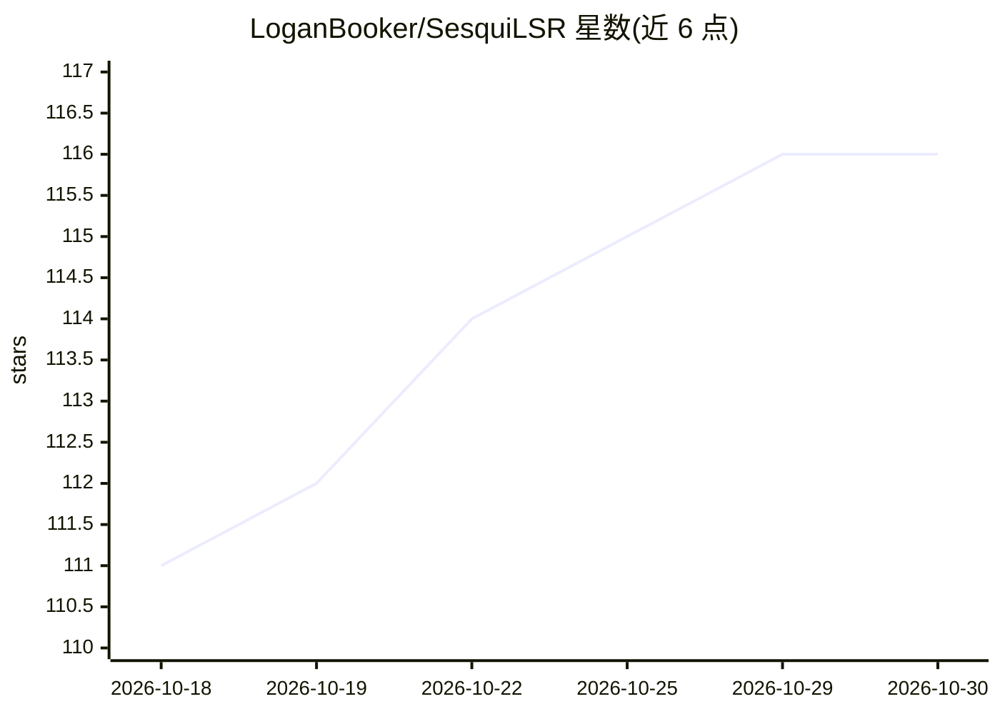

# LoganBooker/SesquiLSR

⭐ 116 · Python · MIT · 推送 2026-10-05 · [GitHub](https://github.com/LoganBooker/SesquiLSR) · 个人维护

**SDXL/Flux/Wan 等扩散模型的任意倍率隐空间放大器**

单一架构（约 3M 参数、约 12MB 权重）在 VAE 隐空间直接放大 1.0-2.0x 任意倍率，通过 PixelShuffle 到 2x 再经学习式下采样到目标尺寸；格式适配器处理各管线的隐空间变换（如 patch 化），使新模型无需重训。支持 SDXL、Flux/Flux2、Wan 2.x、Qwen Image、Anima 等模型/VAE，附 ComfyUI 节点与预训练权重，README 报告隐空间推理低于 6ms。定位为替代双线性/双三次隐空间插值，用于二次去噪前的预处理，非替代 GAN 上采样管线。训练代码尚未发布。

## 筛选速览

| 维度 | 判定 | 备注 |
|---|---|---|
| AI 角色 | `ai-native` | 本体是模型或模型工具 |
| 许可风险 | `permissive` | MIT |
| 部署形态 | `None` |  |
| 模型依赖 | — | README 未给出锁定关系 |
| 硬件要求 | — | 无带数字的原话,不猜 |
| 安装摩擦 | `low` | 无编译、无系统依赖或容器化 |
| 成熟度 | — | 结构信号不足 |

## 能力要点

- 单架构支持 SDXL/Flux/Flux2/Wan/Qwen Image/Anima 等多种 VAE
- 任意 1.0-2.0x 分数倍率隐空间放大，~3M 参数、~12MB 权重
- 附 ComfyUI 节点（drop-in）与各模型预训练权重
- 格式适配器处理管线级隐空间变换，新模型仅需新适配器

## 适用场景

- 扩散模型图像放大工作流中替代双线性/双三次隐空间插值
- 在 ComfyUI 中做低去噪强度的二次去噪前处理
- 多模型（SDXL/Flux/Wan 等）共用同一隐空间放大组件

## 场景标签

`图像视频处理` · 领域:感知与多模态

## 证据(README 行号)

> L3: Latent upscaler supporting arbitrary scales between 1.0-2.0x for various models/VAEs. The name comes from *sesqui*- 
> L10: - **Sub-6ms inference** in latent space, with no VAE round-trip

## 星数曲线

2026-10-18 111 → 2026-10-30 116（+5）

---
*卡片 v1 · prompt 1.4 · 生成 2026-10-23 · 置信度 high · 依据 README sha `0288c3052478` · [字段定义](../../DATASET.md)*
