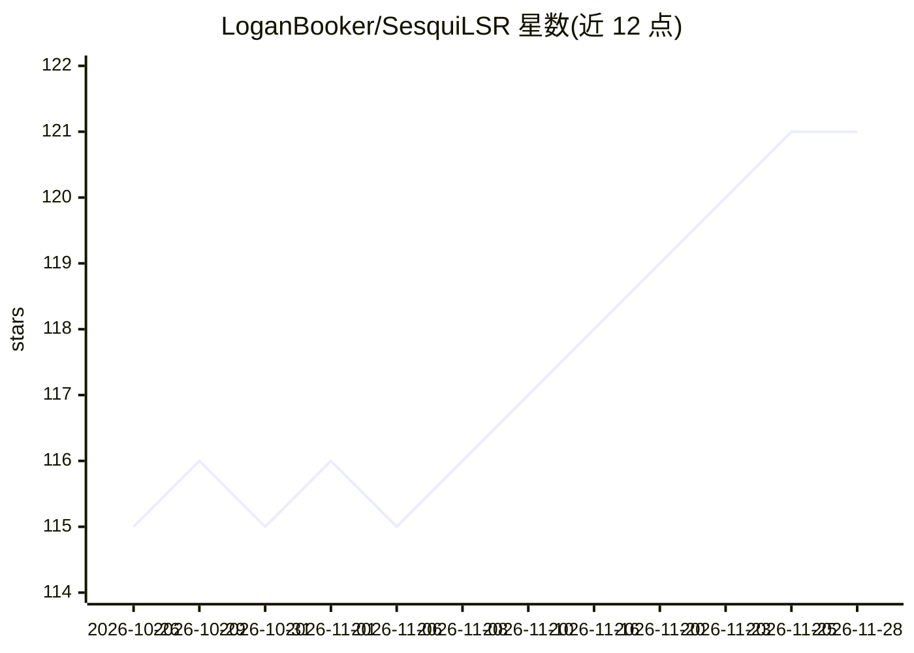

# LoganBooker/SesquiLSR

⭐ 121 · Python · MIT · 推送 2026-11-21 · [GitHub](https://github.com/LoganBooker/SesquiLSR) · 个人维护

**面向 SDXL/Flux/Wan 等模型的任意倍率 latent 上采样器**

一个约 3M 参数、权重约 12MB 的 latent 空间上采样模型，支持 1.0-2.0x 之间任意倍率缩放，无需 VAE 往返，推理约 6ms。按 VAE 分组提供 SDXL、Flux、Flux2、Wan 2.1 等四组预训练权重，通过格式适配器适配不同流水线的 latent 格式。定位为替代双线性/双三次插值的前置 latent 上采样步骤，供后续降噪 pass 使用。提供 Python API 与 ComfyUI 节点，训练方法在 README 中概述但训练代码尚未发布。

## 筛选速览

| 维度 | 判定 | 备注 |
|---|---|---|
| AI 角色 | `ai-native` | 本体是模型或模型工具 |
| 许可风险 | `permissive` | MIT |
| 部署形态 | `None` |  |
| 模型依赖 | — | README 未给出锁定关系 |
| 硬件要求 | — | 无带数字的原话,不猜 |
| 安装摩擦 | `low` | 无编译、无系统依赖或容器化 |
| 成熟度 | — | 结构信号不足 |

## 能力要点

- 支持 [1.0x, 2.0x] 区间任意倍率的 latent 上采样
- 单架构覆盖 SDXL、Flux、Flux2、Wan 2.1 等多组模型/VAE
- 约 3M 参数约 12MB 权重，latent 空间推理约 6ms
- 内置 ComfyUI 节点，无需连接模型或 VAE

## 适用场景

- 在 ComfyUI 流程中替代双线性/双三次 latent 插值做二次降噪前的放大
- 为 SDXL/Flux/Wan 等流水线添加小参数量的任意倍率放大节点
- 对比研究不同 latent 上采样方法的 LPIPS/PSNR 表现

## 场景标签

`图像视频处理` · 领域:感知与多模态

## 证据(README 行号)

> L3: Latent upscaler supporting arbitrary scales between 1.0-2.0x for various models/VAEs. The name comes from *sesqui*- 
> L7: - **Multi-model support** - SDXL, Flux, Z-Image Turbo, Flux2 Klein, Krea 2, Wan 2.1, Qwen Image and Anima from a sin

## 星数曲线

2026-10-26 115 → 2026-11-28 121（+6）

---
*卡片 v1 · prompt 1.4 · 生成 2026-11-28 · 置信度 high · 依据 README sha `a97357b6146b` · [字段定义](../../DATASET.md)*
