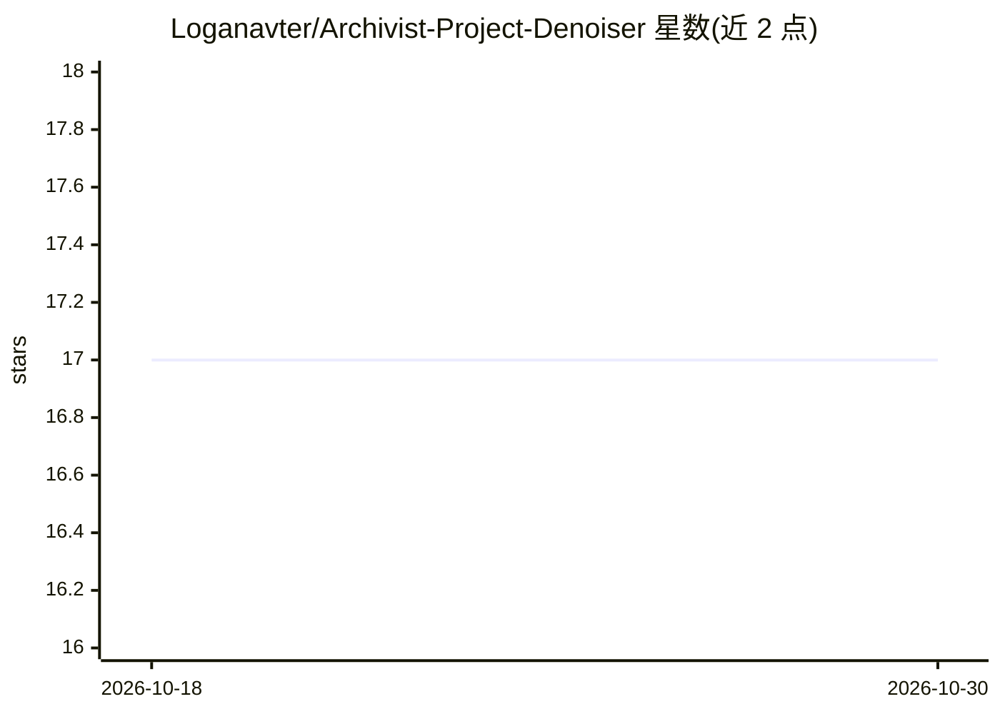

# Loganavter/Archivist-Project-Denoiser

⭐ 17 · Python · MIT · 推送 2025-12-28 · [GitHub](https://github.com/Loganavter/Archivist-Project-Denoiser) · 个人维护

**赛璐璐动画修复模型集与配套物理退化模拟数据集生成器**

包含两部分：Archivist 是一组基于 Real-ESRGAN Compact (48nf16nc, 1x) 的修复模型，针对 1940s-1980s 老赛璐璐动画的划痕、撕裂、污渍、乳剂偏移等缺陷，提供 AntiLines/Rough/Medium/Soft/RGB 五个可下载的 .pth 模型，推荐经 REAL-Video-Enhancer 加载并配合 DRUNet 两阶段流水线使用；Project Degrader 是 PyQt6 编写的 GUI 应用，通过模拟胶片几何形变、缺陷、化学退化与数字伪影生成 LQ/GT 训练数据对，需 Python 3.10+ 与 FFmpeg，通过 launcher.sh 运行。

## 筛选速览

| 维度 | 判定 | 备注 |
|---|---|---|
| AI 角色 | `ai-native` | 本体是模型或模型工具 |
| 许可风险 | `permissive` | MIT |
| 部署形态 | `None` |  |
| 模型依赖 | — | README 未给出锁定关系 |
| 硬件要求 | — | 无带数字的原话,不猜 |
| 安装摩擦 | `medium` | 含编译或系统依赖之一 |
| 成熟度 | — | 结构信号不足 |

## 能力要点

- 5 个针对老赛璐璐动画缺陷的 Real-ESRGAN Compact 修复模型（.pth 下载）
- 两阶段工作流：Archivist 修复结构 + DRUNet 数学降噪稳定
- 物理化模拟的退化流水线：几何形变、智能划痕、化学污渍、MPEG 压缩等
- PyQt6 GUI：放大镜对比预览、JSON 预设管理、多线程批量生成 LQ/GT 对

## 适用场景

- 修复老动画素材中的划痕、污渍与噪点
- 为胶片修复模型生成物理仿真的训练数据集
- 在 REAL-Video-Enhancer 中加载模型做视频修复

## 场景标签

`图像视频处理` · 领域:感知与多模态

## 证据(README 行号)

> L11: **Archivist** is a set of Real-ESRGAN Compact (48nf16nc) models trained to handle specific defects found in old cel
> L13: Unlike general-purpose denoisers, these models were trained on a **physically-simulated degradation pipeline** (see

## 星数曲线

2026-10-18 17 → 2026-10-30 17（+0）

---
*卡片 v1 · prompt 1.4 · 生成 2026-10-30 · 置信度 high · 依据 README sha `b37267e81d03` · [字段定义](../../DATASET.md)*
