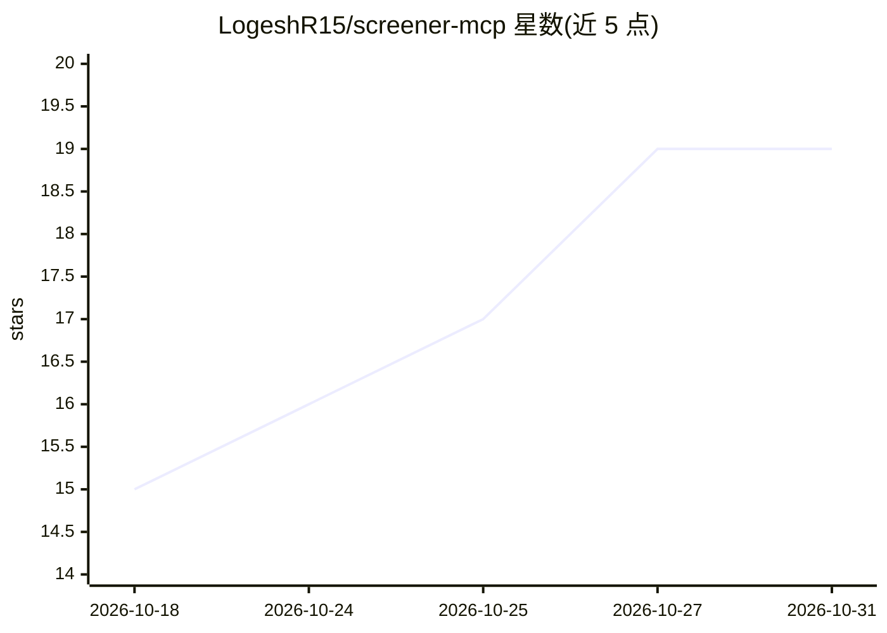

# LogeshR15/screener-mcp

⭐ 19 · Python · MIT · 推送 2026-10-20 · [GitHub](https://github.com/LogeshR15/screener-mcp) · [官网](https://logeshr15.github.io/screener-mcp/) · 个人维护

**给 Claude 接入印度股市数据的 MCP 服务器（Screener.in/NSE/MCX）**

面向 Claude Code/Claude Desktop 及任意 MCP 客户端的 Model Context Protocol 服务器：抓取并标准化 Screener.in、NSE、MCX 数据，提供 30 个工具覆盖公司财务、股票筛选（含技术条件）、相对估值、护城河信号、分析师预期、NSE 公告与大宗交易、本地持仓跟踪；[ai] 扩展加入本地 RAG 管道用于年报与业绩电话会问答（依赖 pdfplumber/chromadb/sentence-transformers，约 1–2GB）。数据分析与解读由 Claude 完成，服务器只供数据。基本面筛选需免费 Screener.in 登录，其余多数工具免登录。通过 uvx/pip 安装，也支持 Docker 与 HTTP 远程部署。

## 筛选速览

| 维度 | 判定 | 备注 |
|---|---|---|
| AI 角色 | `ai-ecosystem` | LLM/agent 周边工具 |
| 许可风险 | `permissive` | MIT |
| 部署形态 | `self-host` | docker 或自建部署 |
| 模型依赖 | locked-api |  |
| 硬件要求 | — | 无带数字的原话,不猜 |
| 安装摩擦 | `low` | 无编译、无系统依赖或容器化 |
| 成熟度 | — | 结构信号不足 |

## 能力要点

- 30 个工具：公司研究、筛选、估值、公告、组合跟踪
- [ai] 扩展提供年报/电话会本地 RAG 问答
- 统一响应信封，部分或降级数据显式标注
- 支持 Claude Code、Claude Desktop 与任意 MCP 客户端，stdio/HTTP/Docker 部署

## 适用场景

- 让 Claude 用实时数据比较印度上市公司财务与估值
- 按基本面与技术条件筛选 NSE 股票并排查红旗信号
- 对年报和业绩电话会做问答式研究
- 本地跟踪持仓并查看实时盈亏

## 场景标签

`金融量化` `RAG` · 领域:知识与检索

## 证据(README 行号)

> L3: An MCP (Model Context Protocol) server that gives Claude live access to Screener.in, NSE, and MCX data — turning Cla
> L12: `screener-mcp` connects Claude (Claude Code, Claude Desktop, or any MCP client) to Indian equity data: company fina
> L100: `screener-mcp` fetches and normalizes the data; Claude does the analysis and explains it in plain language.

## 星数曲线

2026-10-18 15 → 2026-10-31 19（+4）

---
*卡片 v1 · prompt 1.4 · 生成 2026-10-29 · 置信度 high · 依据 README sha `4dc6c7241fac` · [字段定义](../../DATASET.md)*
