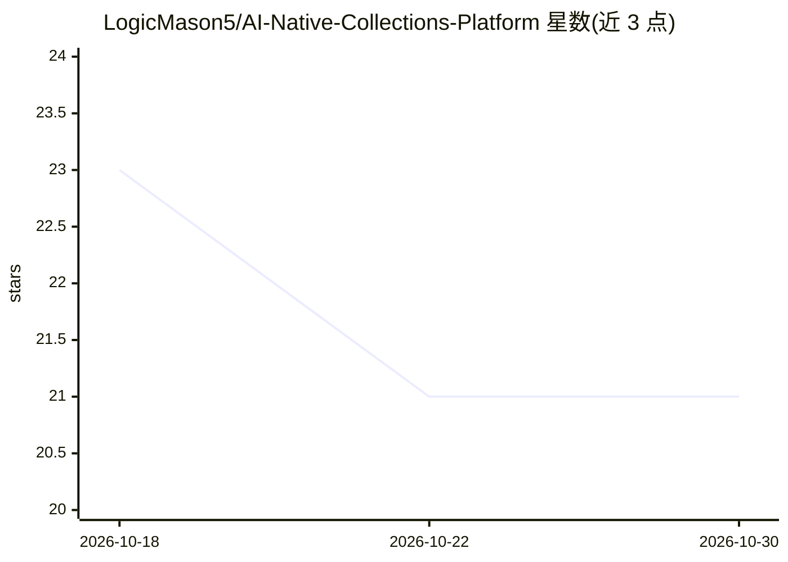

# LogicMason5/AI-Native-Collections-Platform

⭐ 21 · TypeScript · 推送 2026-05-19 · [GitHub](https://github.com/LogicMason5/AI-Native-Collections-Platform) · [官网](https://skit.ai/) · 个人维护

**面向受监管贷方的生成式 AI 债务催收平台介绍（Skit.ai）**

该仓库 README 描述 Skit.ai 商业平台：用生成式 AI 与对话式代理（语音代理、短信、邮件、聊天机器人）为银行、金融科技、汽车金融与第三方催收机构等受监管行业执行催收外呼自动化；内嵌 FDCPA、TCPA、Reg F 等合规规则与审计追踪，并用 AI 模型预测回款倾向、组合分层与外呼时机/渠道优化；可与现有 CRM、拨号器、支付网关集成。README 为介绍性文档，未提供安装命令或代码运行方式。

## 筛选速览

| 维度 | 判定 | 备注 |
|---|---|---|
| AI 角色 | `ai-native` | 本体是模型或模型工具 |
| 许可风险 | `none` | — |
| 部署形态 | `None` |  |
| 模型依赖 | — | README 未给出锁定关系 |
| 硬件要求 | — | 无带数字的原话,不猜 |
| 安装摩擦 | `low` | 无编译、无系统依赖或容器化 |
| 成熟度 | — | 结构信号不足 |

## 能力要点

- 语音/短信/邮件/聊天多渠道对话式 AI 外呼
- 内嵌 FDCPA/TCPA/Reg F 等合规规则与审计追踪
- AI 模型预测回款倾向、组合分层与外呼时机优化
- 与现有 CRM、拨号器、支付网关集成

## 适用场景

- 银行将逾期资产组合交由平台做初次外呼与筛查，人工坐席仅处理复杂案件
- 汽车金融机构用语音机器人加短信跟进并追踪还款承诺
- 医疗机构在保证 HIPAA 合规与审计日志的前提下管理患者欠款外呼
- 先运行 30-60 天试点评估单次解决成本再全面推广

## 场景标签

`语音 Agent` `聊天机器人` · 领域:对话与助手

## 证据(README 行号)

> L4: Skit.ai is a platform that uses generative AI and conversational agents to transform debt collections operations for
> L7: - Omnichannel conversational AI: voice agents, SMS, email and chatbots working together to reach consumers. :content

## 星数曲线

2026-10-18 23 → 2026-10-30 21（-2）

---
*卡片 v1 · prompt 1.4 · 生成 2026-10-28 · 置信度 low · 依据 README sha `b060a8808065` · [字段定义](../../DATASET.md)*
