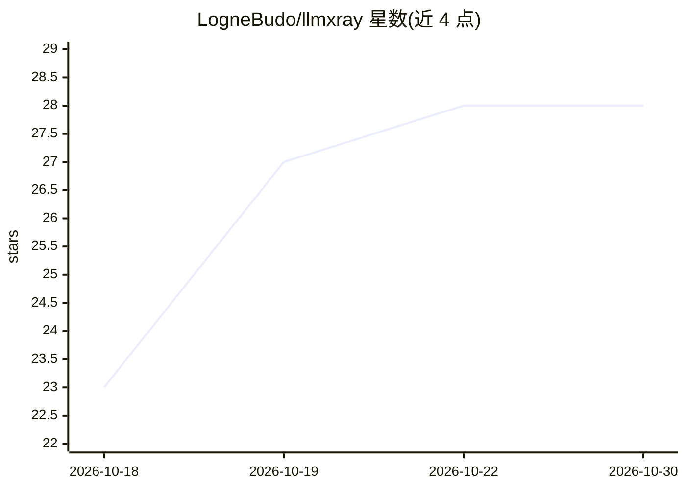

# LogneBudo/llmxray

⭐ 28 · Vue · Apache-2.0 · 推送 2026-10-29 · [GitHub](https://github.com/LogneBudo/llmxray) · [官网](https://lognebudo.github.io/llmxray/) · 个人维护 · 中文 README

**本地 Ollama 观测代理：让工具经它转发调用并可视化每轮细节**

面向使用本地 Ollama 的开发者与 agent 的观测工具：在 11435 端口开一个行为与 Ollama 一致并转发全部请求的代理，把 VS Code Copilot、Open WebUI、Continue、n8n 或自有脚本的调用导向它，即可在 Web 界面查看每轮的缓存命中、prefill/生成速度、工具调用、被 daemon 截断的 prompt，以及共享 GPU 场景下各工具互相的代价。附带 Prompt X-ray、Runs 瀑布图、GPU 显存地图、13 种工具调用形状评分、Cache Lab 缓存测量、三协议对比，并可将每轮以 OpenTelemetry span 发送到 Jaeger/Phoenix/Langfuse/Grafana。另提供 7 个只读工具的 MCP server。需先运行 Ollama 并拉取至少一个模型。

## 筛选速览

| 维度 | 判定 | 备注 |
|---|---|---|
| AI 角色 | `ai-ecosystem` | LLM/agent 周边工具 |
| 许可风险 | `permissive` | Apache-2.0 |
| 部署形态 | `self-host` | docker 或自建部署 |
| 模型依赖 | local-ok | 支持本地模型 |
| 硬件要求 | — | 无带数字的原话,不猜 |
| 安装摩擦 | `low` | 无编译、无系统依赖或容器化 |
| 成熟度 | — | 结构信号不足 |

## 能力要点

- 行为与 Ollama 一致的 11435 代理端口，记录转发调用并给出 findings
- Prompt X-ray 按比例绘制每轮 prompt 组成与缓存命中/重读/截断状态
- 7 个只读 MCP 工具供 agent 自诊（缓存丢失、上下文超限、CPU 卸载等）
- OpenTelemetry span 导出至 Jaeger/Phoenix/Langfuse/Grafana

## 适用场景

- 排查编辑器或 agent 每轮重读全部 prompt、缓存失效的原因
- 多人共享一台 GPU 机器时定位哪个工具拖慢了 Ollama
- 测量把时间戳移到 prompt 末尾带来的缓存复用收益
- 让本地运行的 agent 通过 MCP 工具诊断自己的模型调用

## 场景标签

`LLM 可观测性` · 领域:评测与运维

## 证据(README 行号)

> L21:  Point VS Code Copilot, Open WebUI, Continue, n8n or your own agent at LLMxRay instead of Ollama, and see every tur
> L63: Now point your tools at **http://localhost:11435** instead of Ollama's 11434: VS Code Copilot, Open WebUI, Continue

## 星数曲线

2026-10-18 23 → 2026-10-30 28（+5）

---
*卡片 v1 · prompt 1.4 · 生成 2026-10-26 · 置信度 high · 依据 README sha `e800fd1b11b1` · [字段定义](../../DATASET.md)*
