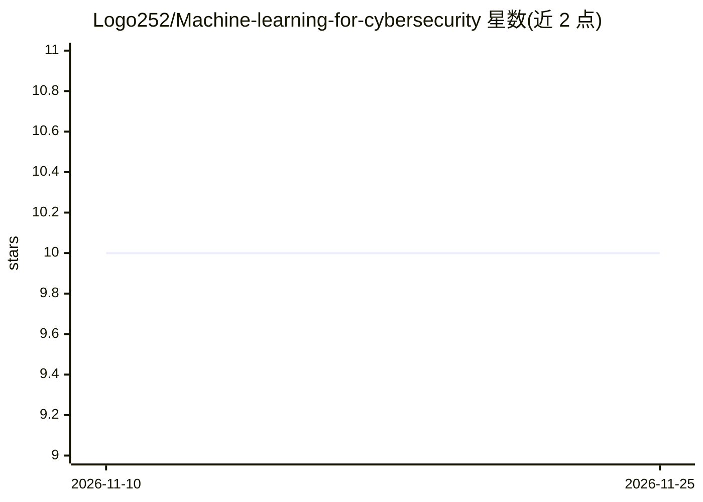

# Logo252/Machine-learning-for-cybersecurity

⭐ 10 · Python · 推送 2026-11-09 · [GitHub](https://github.com/Logo252/Machine-learning-for-cybersecurity) · 个人维护

**机器学习方法在网络安全问题上的性能对比项目**

README 仅三行可见内容：该项目对不同机器学习方法在多类计算机安全问题上的表现进行对比。技术标签为 Python/python3，主题涉及机器学习与网络安全。除对比研究这一目标外，README 未说明具体方法清单、数据集、使用对象或安装运行方式，无法进一步核实其结构与交付形式。

## 筛选速览

| 维度 | 判定 | 备注 |
|---|---|---|
| AI 角色 | `ai-knowledge` | 知识聚合/清单类 |
| 许可风险 | `none` | — |
| 部署形态 | `None` |  |
| 模型依赖 | — | README 未给出锁定关系 |
| 硬件要求 | — | 无带数字的原话,不猜 |
| 安装摩擦 | `low` | 无编译、无系统依赖或容器化 |
| 成熟度 | — | 结构信号不足 |

## 能力要点

- 对比不同机器学习方法在计算机安全问题上的性能
- 基于 Python（python3）实现

## 适用场景

- 了解机器学习方法在网络安全任务上的表现差异
- 作为安全领域机器学习实验的参考

## 场景标签

`网络安全` · 领域:学习与行业

## 证据(README 行号)

> L3: The comparison of the performance of different machine learning methods for various computer security problems.

## 星数曲线

2026-11-10 10 → 2026-11-25 10（+0）

---
*卡片 v1 · prompt 1.4 · 生成 2026-11-20 · 置信度 low · 依据 README sha `731f47bf2e91` · [字段定义](../../DATASET.md)*
