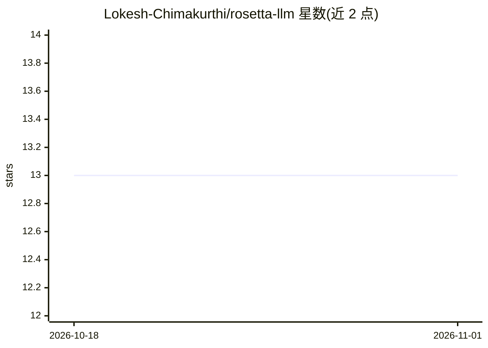

# Lokesh-Chimakurthi/rosetta-llm

⭐ 13 · Python · 推送 2026-09-26 · [GitHub](https://github.com/Lokesh-Chimakurthi/rosetta-llm) · [官网](https://pypi.org/project/rosetta-llm/) · 个人维护

**多格式 LLM API 翻译代理网关，兼容 Claude Code**

用 FastAPI 实现的本地 LLM 代理：在 OpenAI Chat Completions、OpenAI Responses 与 Anthropic Messages 三种 API 格式间双向翻译，经规范化中间表示无损转换 thinking blocks、tool calls 与 reasoning，格式匹配时走零开销直通路径。作为 Claude Code 网关运行时，所有已配置 provider 的模型（含非 Anthropic 模型，经 claude-code/ 前缀处理）可出现在 /model 选择器中。支持 <provider>/<model> 前缀路由、可选 Bearer 认证与结构化日志。提供 uvx、uv tool、Docker 与源码四种安装运行方式。

## 筛选速览

| 维度 | 判定 | 备注 |
|---|---|---|
| AI 角色 | `ai-ecosystem` | LLM/agent 周边工具 |
| 许可风险 | `none` | — |
| 部署形态 | `self-host` | docker 或自建部署 |
| 模型依赖 | — | README 未给出锁定关系 |
| 硬件要求 | — | 无带数字的原话,不猜 |
| 安装摩擦 | `low` | 无编译、无系统依赖或容器化 |
| 成熟度 | — | 结构信号不足 |

## 能力要点

- 三种端点格式经规范化 IR 双向翻译，支持流式
- 格式匹配时零开销 passthrough 直通
- Claude Code 网关集成，非 Anthropic 模型经 claude-code/ 前缀进入模型选择器
- <provider>/<model> 前缀路由与可选代理级认证

## 适用场景

- 让任意客户端 SDK 接入任意 provider，无视原生 API 格式差异
- 在 Claude Code 中使用 OpenAI 等非 Anthropic 模型
- 统一管理多个 LLM provider 的接入与路由

## 场景标签

`模型网关` · 领域:Agent 开发

## 证据(README 行号)

> L3: Multi-format bidirectional translation proxy for LLM APIs. Translates between OpenAI Chat Completions, OpenAI Respon
> L57: - **Claude Code gateway**: full model picker integration — non-Anthropic models appear in `/model` via `claude-code
> L86: Rosetta is a fully compatible Claude Code LLM gateway. Point Claude Code at Rosetta and all configured providers ap

## 星数曲线

2026-10-18 13 → 2026-11-01 13（+0）

---
*卡片 v1 · prompt 1.4 · 生成 2026-10-31 · 置信度 high · 依据 README sha `3e2024585e79` · [字段定义](../../DATASET.md)*
