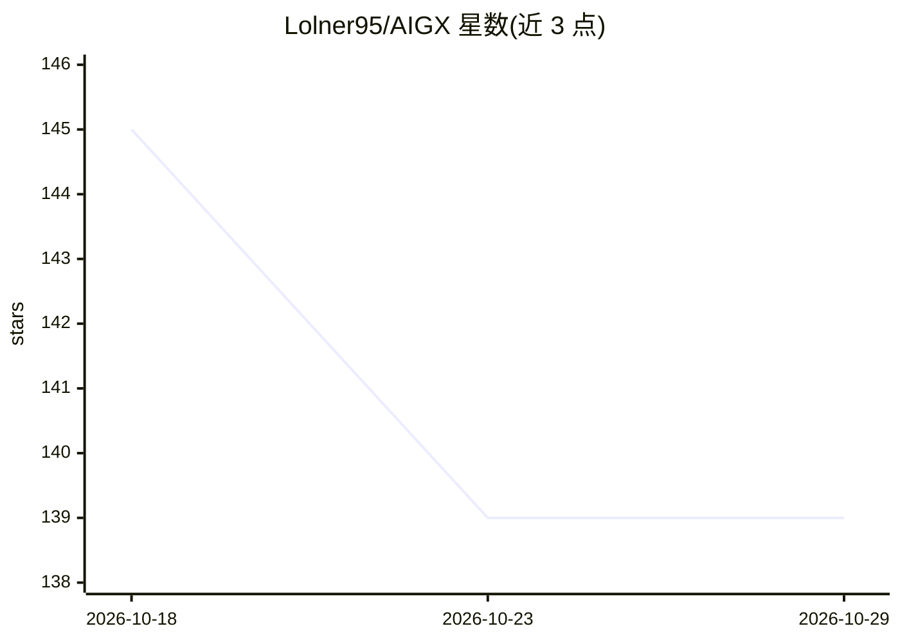

# Lolner95/AIGX

⭐ 139 · Python · NOASSERTION · 推送 2026-09-21 · [GitHub](https://github.com/Lolner95/AIGX) · [官网](https://github.com/Lolner95/AIGX#readme) · 个人维护

**面向 AI 编码代理的开放上下文格式：集中规则+按文件边界索引**

AIGX 定义一种开放格式（Spec v1.1，含 ABNF 语法与 JSON schema），把代码库的 AI 代理规则存放在 .aigx/ 目录，通过 files.aigx 按文件索引将适用规则、禁止导入与陷阱绑定到具体文件，不向源码注入内容。提供 Node/Python/Rust 三套参考实现（npm/PyPI/crates.io）与统一 CLI（init/lint/resolve/doctor 等），支持导出为 AGENTS.md/CLAUDE.md 等格式接入 Cursor、Claude Code、Copilot 等代理，并可接入 CI 校验与 MCP。附有自建受控基准测试结果。规范 CC-BY-4.0、工具 MIT 双许可。

## 筛选速览

| 维度 | 判定 | 备注 |
|---|---|---|
| AI 角色 | `ai-ecosystem` | LLM/agent 周边工具 |
| 许可风险 | `none` | NOASSERTION |
| 部署形态 | `library` | 以包/库形式分发 |
| 模型依赖 | — | README 未给出锁定关系 |
| 硬件要求 | — | 无带数字的原话,不猜 |
| 安装摩擦 | `low` | 无编译、无系统依赖或容器化 |
| 成熟度 | — | 结构信号不足 |

## 能力要点

- .aigx/ 目录 + 按文件边界索引（files.aigx），不注入源码
- Node/Python/Rust 三套参考实现，由一致性测试套件对齐
- 导出到 AGENTS.md/CLAUDE.md 等 6 种代理配置，工具无关
- 规范含 ABNF 语法、JSON schema 与 IANA 媒体类型模板

## 适用场景

- 把团队编码规范结构化地喂给多个 AI 编码代理
- 在 CI 中校验 .aigx 基因组防止规则失效
- 按文件查询该文件适用的规则与禁项后交给代理编辑

## 场景标签

`提示工程` · 领域:Agent 开发

## 证据(README 行号)

> L22: **AIGX (AI Genome Exchange)** stores a codebase's AI-agent rules in a centralized `.aigx/` directory with a
> L24: only context format ever validated in a controlled benchmark**, where it was the **only format to rank
> L233: AIGX isn't out to replace `AGENTS.md` — it's the **genome layer**: a richer, *measured*, per-file-precise

## 星数曲线

2026-10-18 145 → 2026-10-29 139（-6）

---
*卡片 v1 · prompt 1.4 · 生成 2026-10-23 · 置信度 high · 依据 README sha `4b3d1fc12574` · [字段定义](../../DATASET.md)*
