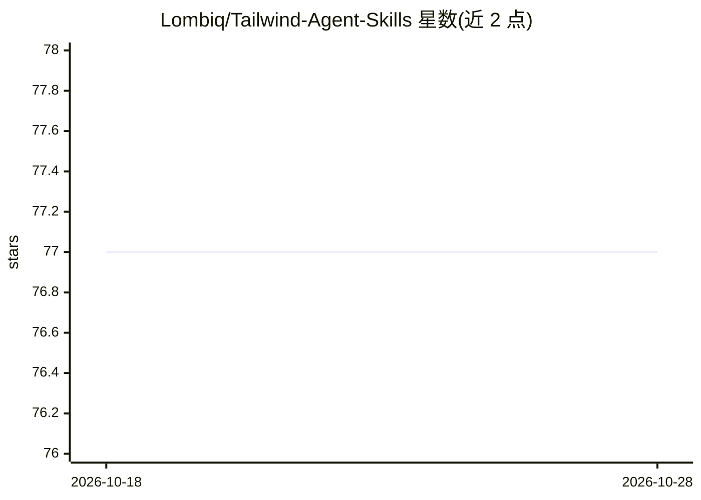

# Lombiq/Tailwind-Agent-Skills

⭐ 77 · Python · BSD-3-Clause · 推送 2026-04-09 · [GitHub](https://github.com/Lombiq/Tailwind-Agent-Skills) · 组织维护

**Tailwind CSS v4 的 agent 技能包：本地文档快照与索引**

Lombiq 维护的 Tailwind v4 开发 agent 技能仓库，含 tailwind-4-docs 技能：整理的 gotchas 清单、面向 agent 的工程 playbook，以及用 Python 脚本从 tailwindcss.com 生成/刷新本地文档快照与 docs-index.tsx 索引的机制。因上游许可不随包分发文档，用户需自行接受许可并运行同步脚本初始化快照（超过一周需刷新）。安装方式为 npx skills add 或手动复制到各 agent 的 skills 目录，支持 Copilot、Codex、Claude Code。

## 筛选速览

| 维度 | 判定 | 备注 |
|---|---|---|
| AI 角色 | `ai-knowledge` | 知识聚合/清单类 |
| 许可风险 | `permissive` | BSD-3-Clause |
| 部署形态 | `library` | 以包/库形式分发 |
| 模型依赖 | — | README 未给出锁定关系 |
| 硬件要求 | — | 无带数字的原话,不猜 |
| 安装摩擦 | `low` | 无编译、无系统依赖或容器化 |
| 成熟度 | — | 结构信号不足 |

## 能力要点

- 镜像官方 Tailwind 文档结构，agent 可按需加载
- 本地生成 docs-index.tsx 映射分类与 slug 到 MDX 文件
- 同步脚本可初始化/刷新快照并记录上游 commit hash
- 因上游许可不分发文档本体，需用户自行接受许可

## 适用场景

- 让 coding agent 在 Tailwind v4 开发、配置、迁移任务中查文档
- 为 Tailwind 项目评审/重构提供面向 agent 的工程 playbook
- 离线环境下让 agent 引用本地文档快照

## 场景标签

 · 领域:前端开发/agent 技能

## 证据(README 行号)

> L5: This repository contains agent skills for Tailwind v4 development tasks. With these skills, you can use your favorit
> L23: An agent-optimized workflow for Tailwind CSS v4 documentation, including a curated gotchas list, an implementation 

## 星数曲线

2026-10-18 77 → 2026-10-28 77（+0）

---
*卡片 v1 · prompt 1.4 · 生成 2026-10-24 · 置信度 high · 依据 README sha `e2763f58ced0` · [字段定义](../../DATASET.md)*
