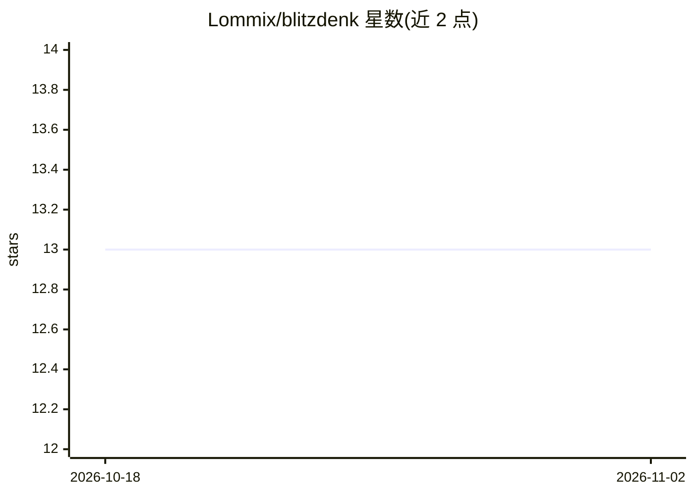

# Lommix/blitzdenk

⭐ 13 · Zig · MIT · 推送 2026-10-31 · [GitHub](https://github.com/Lommix/blitzdenk) · [官网](https://blitzdenk.com) · 个人维护

**用 Lua 编写的可自我改写的极简编码 agent harness**

面向 POSIX 系统的自改进编码代理工具：单二进制（<2MB），内置 vendored Lua，宣称运行内存低于 99MB，无外部依赖。通过 OpenAI/Anthropic 兼容 schema 接入多家模型提供商（含本地 AI），支持 MCP、技能系统、多代理会话持久化、SSH 隧道在远程主机执行工具、热重载代理自我扩展。默认配置含 /plan、/review、/team 等命令。提供 install.sh 安装脚本与预编译二进制，也可用 zig 自行构建。

## 筛选速览

| 维度 | 判定 | 备注 |
|---|---|---|
| AI 角色 | `ai-ecosystem` | LLM/agent 周边工具 |
| 许可风险 | `permissive` | MIT |
| 部署形态 | `desktop` | 安装包/桌面程序 |
| 模型依赖 | — | README 未给出锁定关系 |
| 硬件要求 | — | 无带数字的原话,不猜 |
| 安装摩擦 | `low` | 无编译、无系统依赖或容器化 |
| 成熟度 | — | 结构信号不足 |

## 能力要点

- 单二进制 <2MB，vendored Lua，无依赖
- 支持任意 OpenAI/Anthropic chat/response schema 提供商，含本地 AI
- MCP 与 Skill 支持，Lua 渲染自定义 widget
- 可选 SSH 隧道层，工具在远程主机运行

## 适用场景

- 在终端里运行多代理编码任务并随时恢复会话
- 通过 /improve 命令让代理审查并改进 harness 自身
- 用 Lua 配置自定义命令与 widget 扩展代理行为

## 场景标签

`编码 Agent` `多智能体` · 领域:Agent 开发

## 证据(README 行号)

> L3: A minimal self improving coding harness for POSIX. No dependencies, vendored Lua.
> L21: - Multi-provider: any OpenAI or Anthropic chat/response schema supported, including local AI.

## 星数曲线

2026-10-18 13 → 2026-11-02 13（+0）

---
*卡片 v1 · prompt 1.4 · 生成 2026-10-31 · 置信度 high · 依据 README sha `d3d24e5d1262` · [字段定义](../../DATASET.md)*
