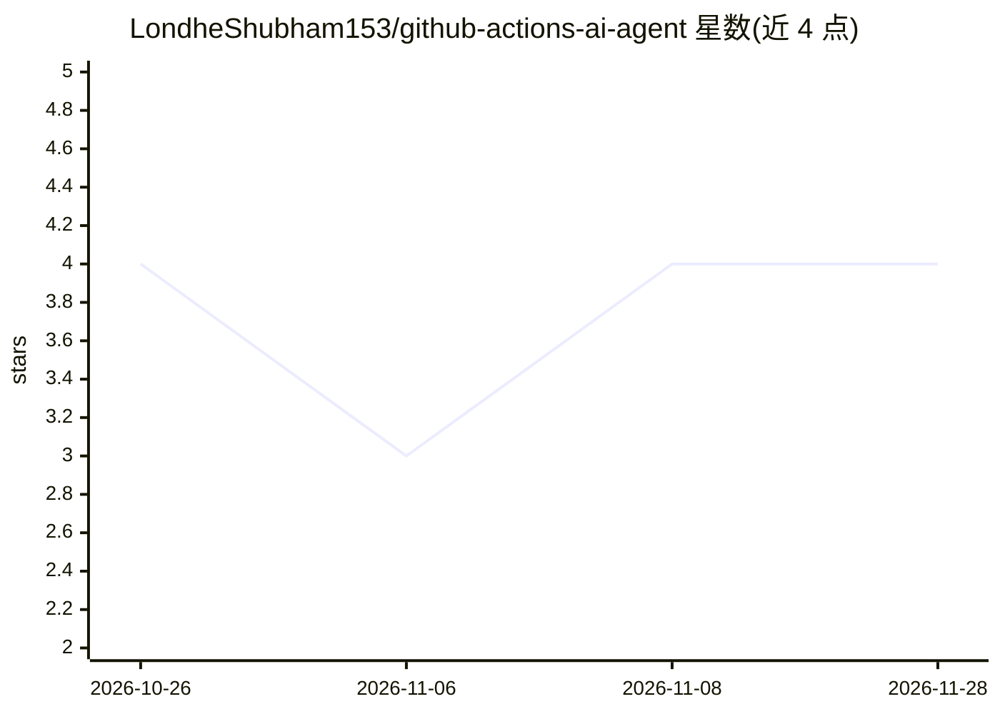

# LondheShubham153/github-actions-ai-agent

⭐ 4 · Python · MIT · 推送 2026-10-20 · [GitHub](https://github.com/LondheShubham153/github-actions-ai-agent) · 个人维护

**用本地模型诊断 GitHub Actions 失败运行的持久化 Agent**

基于 Google ADK 与 Temporal 构建的 Agent：用户提问仓库最近的失败运行，Agent 调用 GitHub API 列出运行、读取失败作业日志尾部并给出基于日志的分析结论；跨问答记住用户身份，worker 进程被杀死后答案仍能通过 workflow 重放完成。约 250 行代码，定位为教学仓库，附架构、内存、安全（只读、仓库白名单、密钥脱敏）文档与 5 个可运行 demo。作者自述未达到生产可用，本地 8B 模型多步工具调用成功率有限。

## 筛选速览

| 维度 | 判定 | 备注 |
|---|---|---|
| AI 角色 | `ai-native` | 本体是模型或模型工具 |
| 许可风险 | `permissive` | MIT |
| 部署形态 | `None` |  |
| 模型依赖 | local-ok | 支持本地模型 |
| 硬件要求 | — | 无带数字的原话,不猜 |
| 安装摩擦 | `low` | 无编译、无系统依赖或容器化 |
| 成熟度 | `idea` | |

## 能力要点

- Temporal workflow 实现崩溃恢复、按步骤重试与重放测试
- Supermemory 提供跨进程用户记忆与租户隔离
- 只读权限、仓库白名单代码级强制、密钥脱敏与不可信输入包装
- 13 个离线测试与无需 API key 的 CI

## 适用场景

- 查询仓库最近的 CI 失败原因并获得日志依据
- 学习如何用 Temporal 构建崩溃安全的 Agent
- 研究 Agent 记忆管理与提示注入防护实践

## 场景标签

`Agent 记忆` `教程课程` · 领域:Agent 开发

## 证据(README 行号)

> L12: **A durable, memory-equipped agent that triages failed GitHub Actions runs.** Ask it "what failed recently on my re
> L16: It is also a **teaching repo**. The agent is about 250 lines, and every moving part is explained, with a runnable d

## 星数曲线

2026-10-26 4 → 2026-11-28 4（+0）

---
*卡片 v1 · prompt 1.4 · 生成 2026-11-21 · 置信度 high · 依据 README sha `ce0948fb79fb` · [字段定义](../../DATASET.md)*
