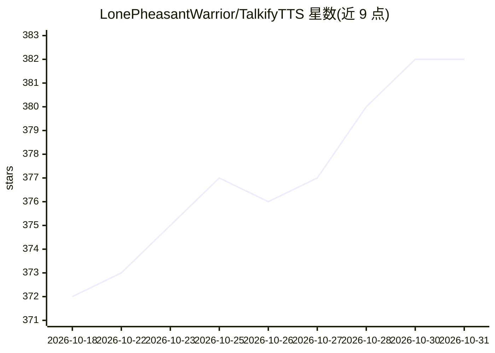

# LonePheasantWarrior/TalkifyTTS

⭐ 382 · Kotlin · MIT · 推送 2026-10-25 · [GitHub](https://github.com/LonePheasantWarrior/TalkifyTTS) · [官网](https://gitee.com/LonePheasantWarrior/talkify) · 个人维护 · 中文 README

**Android TTS 引擎：聚合云端大模型与离线本地语音合成**

基于 Kotlin/Jetpack Compose 的 Android TTS 连接器，实现标准 Android Text-to-Speech 接口，供阅读软件（如 Google Play 图书）调用。接入微软 Azure、火山引擎豆包、腾讯云、阿里云通义千问、MiniMax、小米 MiMo、Google Gemini TTS、OpenAI 八家云端供应商，支持自定义 BaseURL 与模型 ID、HTTP/SOCKS 代理；另内置离线 ZipVoice-Distill 本地引擎（sherpa-onnx int8 推理，12 种中文音色，约 200MB 模型按需下载，非商业许可）。支持流式合成降低首字延迟，最低兼容 Android 11。

## 筛选速览

| 维度 | 判定 | 备注 |
|---|---|---|
| AI 角色 | `ai-native` | 本体是模型或模型工具 |
| 许可风险 | `permissive` | MIT |
| 部署形态 | `None` |  |
| 模型依赖 | — | README 未给出锁定关系 |
| 硬件要求 | — | 无带数字的原话,不猜 |
| 安装摩擦 | `low` | 无编译、无系统依赖或容器化 |
| 成熟度 | — | 结构信号不足 |

## 能力要点

- 8 家云端 TTS 供应商一键切换，Azure 免 API Key 开箱可用
- 离线 ZipVoice-Distill 本地引擎（12 种音色，无网络无调用费用）
- 实现标准 Android TTS 接口，供任意阅读软件调用
- 支持自定义 BaseURL、第三方转接平台与 HTTP/SOCKS 代理

## 适用场景

- 用电子书阅读器朗读时替换系统默认 TTS 获得拟人语音
- 断网环境下用本地离线引擎继续朗读
- 通过自然语言风格指令控制朗读情感与语速

## 场景标签

`语音合成` · 领域:内容生成

## 证据(README 行号)

> L7: Talkify 是一款基于 Android 的现代化 TTS 连接器。它将云端顶尖大模型（微软、通义千问、豆包、腾讯云、MiniMax、小米 MiMo、Google Gemini TTS、OpenAI）的高质量拟人语音合成能力，以及
> L22: - **📱 系统级集成**：实现标准 Android TTS 接口，无缝支持 Legado（阅读）、Google Play图书 等任意支持调用TTS引擎的阅读软件。

## 星数曲线

2026-10-18 372 → 2026-10-31 382（+10）

---
*卡片 v1 · prompt 1.4 · 生成 2026-10-21 · 置信度 mid · 依据 README sha `504949936722` · [字段定义](../../DATASET.md)*
