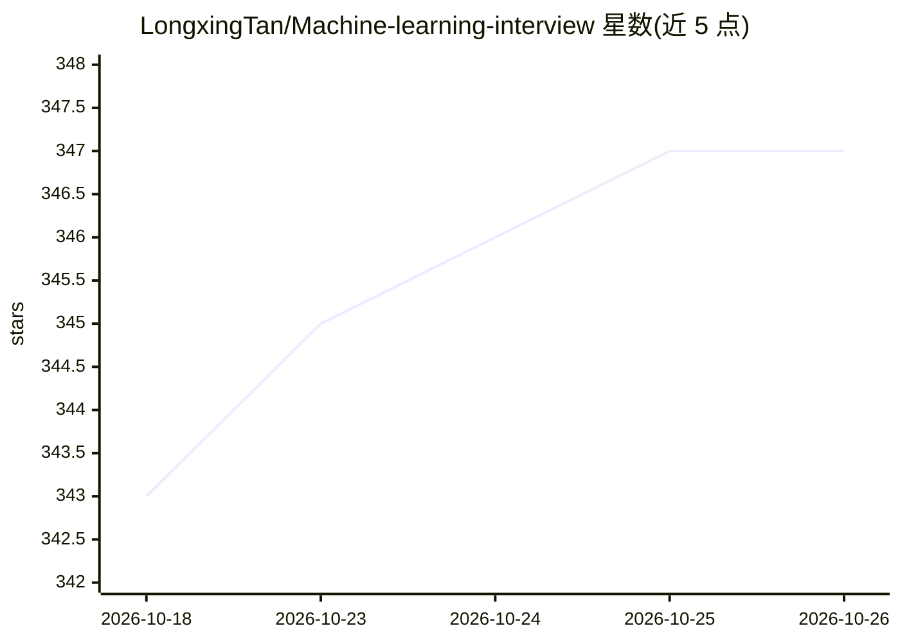

# LongxingTan/Machine-learning-interview

⭐ 347 · 推送 2026-05-30 · [GitHub](https://github.com/LongxingTan/Machine-learning-interview) · [官网](https://longxingtan.gitbook.io/ml-interview/) · 个人维护 · 中文 README

**面向海外/外企大厂的中文 CS 面试指南书籍**

免费中文面试准备书籍（GitBook 发布），覆盖软件工程师、机器学习工程师、数据科学家、应用科学家、AI 工程师、数据工程师等岗位。内容按岗位分四章组织：数据结构与算法、ML 广度/深度、ML 系统设计、系统设计、面向对象设计、统计与因果推断、产品感知、SQL 及行为面试题。以在线书籍形式提供，无代码安装过程。

## 筛选速览

| 维度 | 判定 | 备注 |
|---|---|---|
| AI 角色 | `ai-knowledge` | 知识聚合/清单类 |
| 许可风险 | `none` | — |
| 部署形态 | `None` |  |
| 模型依赖 | — | README 未给出锁定关系 |
| 硬件要求 | — | 无带数字的原话,不猜 |
| 安装摩擦 | `low` | 无编译、无系统依赖或容器化 |
| 成熟度 | — | 结构信号不足 |

## 能力要点

- 覆盖 6 类 CS 岗位的面试内容组织
- 按岗位划分章节（算法/ML/系统设计/行为题/SQL 等）
- 以免费 GitBook 在线书籍形式发布

## 适用场景

- 准备外企或海外大厂的机器学习工程师面试
- 按岗位查找对应的面试考点清单
- 学习 ML 系统设计与行为面试的应答框架

## 场景标签

`教程课程` · 领域:学习与行业

## 证据(README 行号)

> L3: 📚中文面试指南，针对海外、外企、大厂CS岗位。
> L5: - 适用岗位：软件工程师(SDE)、机器学习工程师(MLE)、数据科学家(DS)、应用科学家(AS)、AI工程师、数据工程师

## 星数曲线

2026-10-18 343 → 2026-10-26 347（+4）

---
*卡片 v1 · prompt 1.4 · 生成 2026-10-21 · 置信度 high · 依据 README sha `9645180e6844` · [字段定义](../../DATASET.md)*
