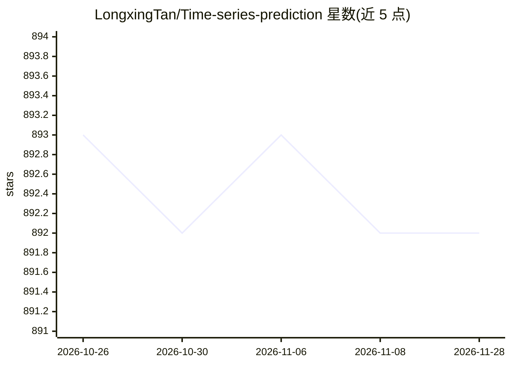

# LongxingTan/Time-series-prediction

⭐ 892 · Python · MIT · 推送 2026-11-01 · [GitHub](https://github.com/LongxingTan/Time-series-prediction) · [官网](https://time-series-prediction.readthedocs.io/en/latest/) · 个人维护 · 中文 README

**面向开发者与研究者的 TensorFlow 时间序列深度学习库**

TFTS 是基于 TensorFlow/Keras 的时间序列软件包，支持预测、分类、异常检测任务的经典与较新深度学习方法，内置 RNN、TCN、N-BEATS、DLinear、Seq2seq、WaveNet、Transformer、Informer、Autoformer、TFT、BERT 等模型，通过 AutoConfig/AutoModel 接口调用。数据输入支持 np.ndarray、tf.data.Dataset 与 tf.keras.utils.Sequence 三种格式，可自定义嵌入层与任务头。README 还记录了 KDD Cup 2022 风电预测第 3 名与天池 ENSO 预测第 4 名的应用结果。

## 筛选速览

| 维度 | 判定 | 备注 |
|---|---|---|
| AI 角色 | `ai-native` | 本体是模型或模型工具 |
| 许可风险 | `permissive` | MIT |
| 部署形态 | `library` | 以包/库形式分发 |
| 模型依赖 | — | README 未给出锁定关系 |
| 硬件要求 | — | 无带数字的原话,不猜 |
| 安装摩擦 | `low` | 无编译、无系统依赖或容器化 |
| 成熟度 | — | 结构信号不足 |

## 能力要点

- 支持预测、分类、异常检测三类时间序列任务
- 内置 11 种以上 AutoModel 模型（transformer/informer/autoformer/nbeats/dlinear 等）
- 提供 AutoConfig/AutoModel 与自定义模型构建接口
- 提供 Optuna 参数调优与 Colab/Kaggle 快速上手示例

## 适用场景

- 为风电、ENSO 等场景训练时序预测模型
- 对时序数据做分类或异常检测
- 在 TensorFlow/Keras 流程中快速试用多种时序模型
- 参加时序类竞赛时作为模型基线库

## 场景标签

 · 领域:机器学习/时间序列

## 证据(README 行号)

> L11: **TFTS** (TensorFlow Time Series) is an easy-to-use time series package, supporting the classical and latest deep l
> L12: - Support sota models for time series tasks (prediction, classification, anomaly detection)

## 星数曲线

2026-10-26 893 → 2026-11-28 892（-1）

---
*卡片 v1 · prompt 1.4 · 生成 2026-11-24 · 置信度 high · 依据 README sha `b209b7662741` · [字段定义](../../DATASET.md)*
