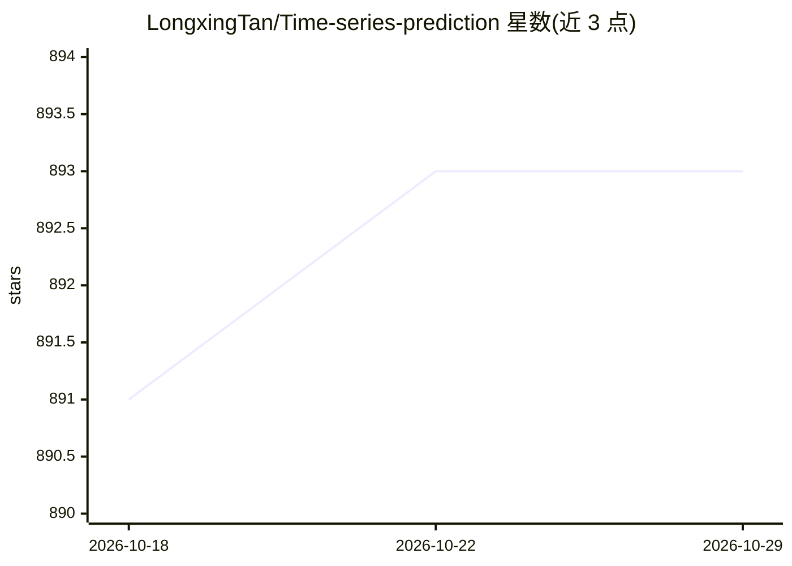

# LongxingTan/Time-series-prediction

⭐ 893 · Python · MIT · 推送 2026-10-26 · [GitHub](https://github.com/LongxingTan/Time-series-prediction) · [官网](https://time-series-prediction.readthedocs.io/en/latest/) · 个人维护 · 中文 README

**给开发者的 TensorFlow 时间序列深度学习模型库**

TFTS 是基于 TensorFlow/Keras 的时间序列深度学习包，支持预测、分类、异常检测任务，内置 RNN、TCN、BERT、NBeats、DLinear、Seq2Seq、Transformer、Informer、Autoformer、TFT 等 AutoModel 模型。提供 KerasTrainer 训练器，输入支持 np.ndarray、tf.data.Dataset 与 keras Sequence 三种形式，可自定义配置、嵌入层与任务头。要求 Python≥3.7、TensorFlow≥2.4，pip 安装。作者曾在 KDD Cup 2022 风电预测获第三名、天池 ENSO 预测 2021 获第四名。

## 筛选速览

| 维度 | 判定 | 备注 |
|---|---|---|
| AI 角色 | `ai-native` | 本体是模型或模型工具 |
| 许可风险 | `permissive` | MIT |
| 部署形态 | `library` | 以包/库形式分发 |
| 模型依赖 | — | README 未给出锁定关系 |
| 硬件要求 | — | 无带数字的原话,不猜 |
| 安装摩擦 | `low` | 无编译、无系统依赖或容器化 |
| 成熟度 | — | 结构信号不足 |

## 能力要点

- 内置 11 种 AutoModel 时间序列模型（rnn/tcn/bert/transformer/tft 等）
- 覆盖预测、分类、异常检测三类任务
- 支持自定义模型配置、嵌入与任务头扩展
- 提供 Optuna 参数调优示例与 Colab/Kaggle 教程

## 适用场景

- 用深度学习模型做时间序列预测
- 对时间序列做分类或异常检测
- 在自定义 3D 数据上训练并扩展模型结构

## 场景标签

 · 领域:时间序列机器学习

## 证据(README 行号)

> L11: **TFTS** (TensorFlow Time Series) is an easy-to-use time series package, supporting the classical and latest deep l
> L12: - Support sota models for time series tasks (prediction, classification, anomaly detection)

## 星数曲线

2026-10-18 891 → 2026-10-29 893（+2）

---
*卡片 v1 · prompt 1.4 · 生成 2026-10-21 · 置信度 high · 依据 README sha `e617e701db12` · [字段定义](../../DATASET.md)*
