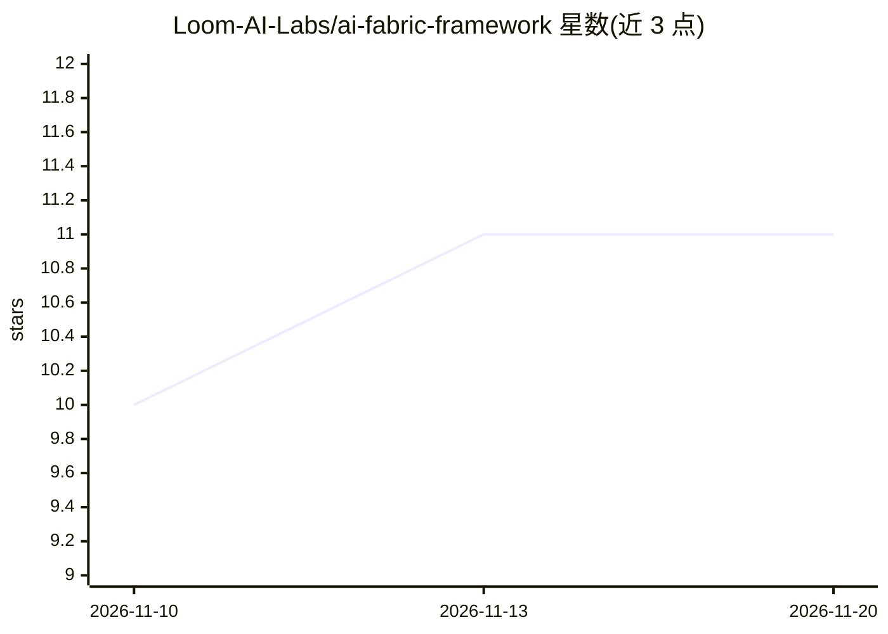

# Loom-AI-Labs/ai-fabric-framework

⭐ 11 · Java · Apache-2.0 · 推送 2026-11-19 · [GitHub](https://github.com/Loom-AI-Labs/ai-fabric-framework) · [官网](https://ai-fabric.dev) · 组织维护

**Java/Spring Boot 应用的 AI 编排框架：RAG、受治理动作与多租户安全**

面向 Java 21 / Spring Boot 4.1.x 应用 intelligence 层框架，基于 Spring AI 构建模型集成与文档 ETL。提供四种构建方式：对话应用、无聊天界面的事件驱动调用、固定顺序/并行计划、自适应多专员团队；配套实体索引与外部数据同步、证据引用输出、动作审批与人工接管流程。按 BOM+模块化依赖选用，向量库与聊天界面均非必需；模型解释与提议，动作执行权由应用持有。

## 筛选速览

| 维度 | 判定 | 备注 |
|---|---|---|
| AI 角色 | `ai-ecosystem` | LLM/agent 周边工具 |
| 许可风险 | `permissive` | Apache-2.0 |
| 部署形态 | `None` |  |
| 模型依赖 | — | README 未给出锁定关系 |
| 硬件要求 | — | 无带数字的原话,不猜 |
| 安装摩擦 | `medium` | 含编译或系统依赖之一 |
| 成熟度 | — | 结构信号不足 |

## 能力要点

- 四种构建方式：对话、事件驱动调用、固定计划、自适应多专员团队
- @AICapable/@AIProcess 注解将实体写操作接入索引，事务与队列同提交
- 受治理动作（审批/驳回/修正/升级）与人工会话接管两种人机参与机制
- 可选本地 ONNX 嵌入；支持 Lucene、Pinecone、Qdrant、Weaviate、Milvus 向量后端

## 适用场景

- 给现有 Spring Boot 业务系统加带引用证据的 RAG 问答
- 在事件处理器或定时任务中调用类型化的分析专员
- 需要审批流与人工接管的企业 AI 动作执行
- 多租户应用中做 PII 与权限边界内的智能检索

## 场景标签

`RAG` `Agent 框架` · 领域:Agent 开发

## 证据(README 行号)

> L41: Built on Spring AI for model integration and document ETL, with opinionated contracts for application
> L170: For an existing **Java 21 / Spring Boot 4.1.x** application with Maven 3.9+.

## 星数曲线

2026-11-10 10 → 2026-11-20 11（+1）

---
*卡片 v1 · prompt 1.4 · 生成 2026-11-19 · 置信度 high · 依据 README sha `8ebf55bf0353` · [字段定义](../../DATASET.md)*
